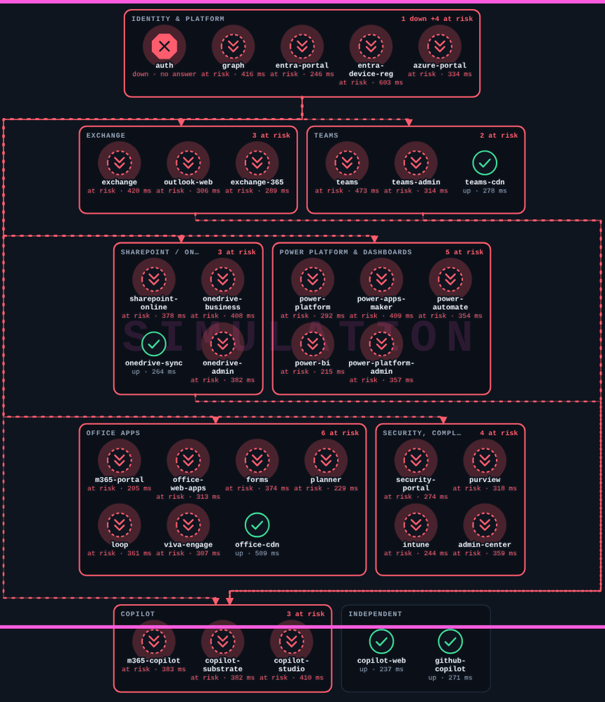
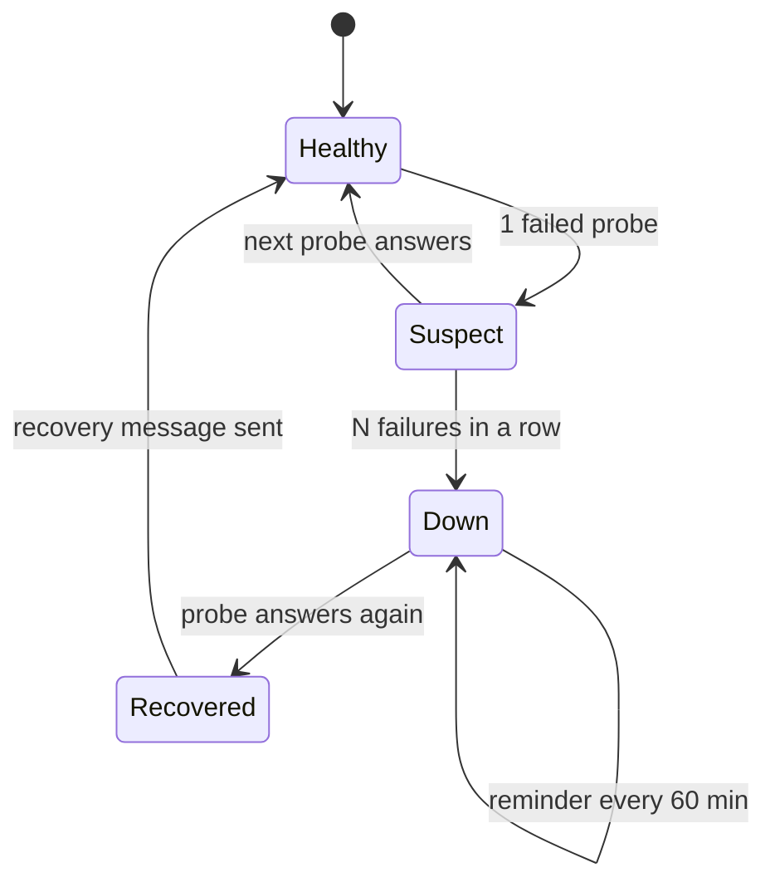
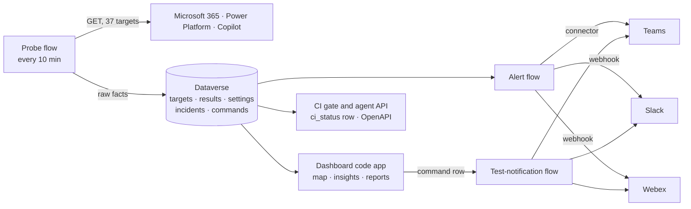
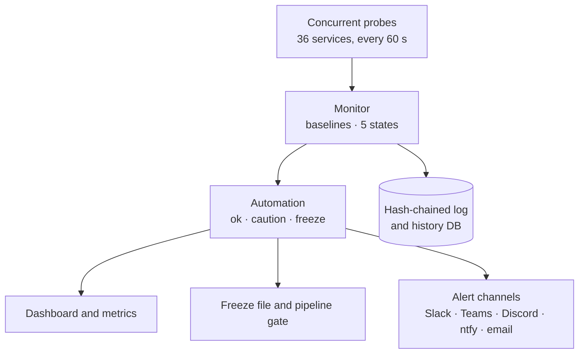
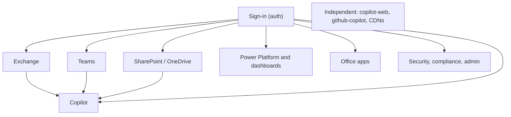

<div align="center">


# Outage Watch

### Hear the tremor before the outage.

**Early-warning monitoring for Microsoft 365, Power Platform and Copilot.**
It checks 36 to 37 services from the outside, learns what normal looks like for each one,
and sends a detailed alert to Teams, Slack or Webex when something fails.
It deploys from a single command.


[**Case study**](#why-this-exists) &nbsp;·&nbsp; [**Quick start**](#quick-start) &nbsp;·&nbsp; [**Features**](#features) &nbsp;·&nbsp; [**Honest limits**](#what-is-proven-and-what-is-not) &nbsp;·&nbsp; [**Connect on LinkedIn**](https://www.linkedin.com/search/results/people/?keywords=Kirolos%20Power%20of%20Automation)

</div>

---

## Why this exists

Microsoft 365 and Outlook had several outages in 2026. For many companies the first sign was a phone call from a user.

| Date (2026) | What was reported | Reported cause |
|---|---|---|
| Jan 22 to 23 | Microsoft 365, many services, nearly ten hours | Load during a maintenance window plus a third-party network provider problem ([The Register](https://www.theregister.com/2026/01/23/microsoft_365_outage/)) |
| Mar 16 | Exchange Online mailbox access | Supporting network infrastructure ([National CIO Review](https://nationalcioreview.com/articles-insights/extra-bytes/breaking-microsoft-exchange-online-outage-disrupts-outlook-email/)) |
| Aug 31 | Outlook and sign-in | Preliminary: an issue in a core authentication configuration shared by several services ([Tom's Guide](https://www.tomsguide.com/au/news/live/microsoft-outlook-outage-august-31-2026)) |
| Nov 6 and 9 | Mail to Outlook.com, and Outlook on the web in EMEA | Smaller incidents, both marked resolved |

> Causes are as reported at the time. Several were preliminary, and Microsoft's final reports may differ.

Status pages lag, and monitoring that runs inside the affected cloud can fail with it.
Outage Watch starts from one rule: **ask the services yourself, from somewhere that does not depend on the thing that might be failing.**

## At a glance

| | |
|---|---|
| **Services watched** | 36 (host edition) or 37 (Power Platform edition), in 9 families |
| **Editions** | A host monitor (Windows, Linux, macOS) and a Power Platform app |
| **States** | `up` · `warning` · `suspect` · `down` · `blocked` |
| **Alert channels** | Teams · Slack · Webex · generic webhook (Power Platform). Slack · Teams · Discord · Telegram · ntfy · Mattermost · email (host) |
| **Deploy** | One command that takes a Power Platform environment ID |
| **Tests** | 126 (host) + 319 (Power Platform) unit tests, plus 84 deploy-script checks |

<div align="center">

&nbsp;

<br><sub>Host edition, simulated sign-in outage, and the staff-language task view. Demo data.</sub>
</div>

## Features

<details open>
<summary><b>Detection: early warning, not just up or down</b></summary>

- Probes public, unauthenticated endpoints for **sign-in, Exchange, Teams, SharePoint and OneDrive, Power Platform and Power BI, Office on the web, security and compliance, and Copilot**.
- Learns each service's own normal speed. When a service answers at three times that baseline (and at least 800 ms slower) it turns to **warning** while it is still up.
- **Blip filtering:** one failed probe is `suspect`, two in a row is `down`.
- **`blocked` is not `down`:** your own proxy or firewall refusing a probe is reported separately, so a locked-down office never raises a false freeze.
- Services that need your tenant name (SharePoint, OneDrive) show as *not set up*, never as failures.
</details>

<details>
<summary><b>Dashboard: the blast-radius map, insights and staff view</b></summary>

- A dependency map from sign-in to every service and to Copilot, with failures spreading along the lines. State is shown by shape, icon and text, never colour alone.
- **Probable common cause:** when many services fail together it names the shared dependency, shows the evidence, and says what the probes cannot know.
- **Insights:** drift, flapping services, repeat offenders, a reliability scorecard, alert-noise counts and a post-incident report you can copy or download.
- **"Can I do my job?":** plain tasks (email, meetings, files, Copilot) with a calm, factual staff-update draft that never claims Microsoft's root cause.
- Light and dark themes, phone layouts, and a clearly labelled **simulation mode** so every state can be demoed without an outage.
</details>

<details>
<summary><b>Alerts: Teams, Slack and Webex with the real error</b></summary>

- One message per round, **grouped by family**, with the real error text, URL, HTTP status and timing.
- Opening, reminder and recovery messages, snooze, and a deliberate **"probing stopped"** notice if the probes go silent.
- Per-channel limits counted in bytes, with a visible "message shortened" footer. Mentions and markup in probe data are neutralised.
- An admin **Send test notification now** button posts a labelled live status message to the channels you pick and shows what each returned.
- A warning when an alert channel is hosted on Microsoft 365, because it can fail in the same outage.


</details>

<details>
<summary><b>Automation: CI gate, agent API, incidents and drills</b></summary>

- A **machine-readable "safe to change?" answer** (`ok` / `caution` / `freeze`) with ready-made gate steps for GitHub Actions, Azure DevOps and PowerShell.
- An **OpenAPI definition** so an AI agent can ask about service health (unconfirmed in Copilot Studio).
- An incident table records when each incident began and ended, what failed and the worst error.
- Host edition: **fire drills** that rehearse the 2026 outage patterns with a timed checklist, a **tamper-evident hash-chained log** (`report.py --verify`), uptime and SLA reports, maintenance windows and a dead-man's-switch heartbeat.
</details>

<details>
<summary><b>Deployment: zero-touch, idempotent, with rollback</b></summary>

- Give a Power Platform environment ID. The script checks prerequisites, creates what is missing, runs its own tests, starts the service and smoke-tests it.
- **Re-running is an upgrade.** Tokens, config, data and history are kept. A failed run says what it left behind.
- The Power Platform script **finds your SharePoint tenant name itself** (Azure sign-in, then Microsoft Graph), then verifies the address answers before seeding it. It never seeds a host it has not seen answer.
- Webhook URLs come from a hidden prompt or an environment variable, never the command line, and are never printed, logged or shown on screen.
</details>

## Architecture

**Power Platform edition** (runs in your tenant, 10-minute interval):



**Host edition** (runs outside Microsoft 365 as the independent witness, 60-second interval):



**The dependency model** both editions share:



> **Why two editions?** A flow inside Microsoft's cloud can fail with it. The host edition runs outside as the independent witness. The Power Platform edition is the convenient in-tenant view. **Run both.**

## Quick start

Always start with a dry run. Replace the zeros with your Power Platform environment ID (the part after `/environments/` in the maker portal URL).

<details open>
<summary><b>Power Platform edition</b></summary>

```bat
cd outage-watch-powerplatform
Deploy-OutageWatchPP.cmd 00000000-0000-0000-0000-000000000000 -DryRun
Deploy-OutageWatchPP.cmd 00000000-0000-0000-0000-000000000000
```

Needs a Dataverse environment with code apps enabled, Power Automate Premium for the flow owner and Power Apps Premium for dashboard viewers.
The script asks which alert channels to set up. Teams takes a channel link ("Get link to channel" in Teams). Slack and Webex take an incoming-webhook URL with hidden input.
Add `-SendTestAlert` afterwards to post a labelled TEST message to every channel. Details: [`outage-watch-powerplatform/README.md`](outage-watch-powerplatform/README.md).
</details>

<details>
<summary><b>Host edition on Windows</b></summary>

```bat
cd outage-watch-package
Deploy.cmd 00000000-0000-0000-0000-000000000000 -Yes -Tenant contoso
```

Needs Python 3.9+ for all users and administrator rights. It runs as a start-at-boot scheduled task and listens on `127.0.0.1` only. Details: [`outage-watch-package/README-DEPLOY.txt`](outage-watch-package/README-DEPLOY.txt).
</details>

<details>
<summary><b>Host edition on Linux or macOS, or just run it</b></summary>

```bash
cd outage-watch
./deploy/deploy.sh --env-id 00000000-0000-0000-0000-000000000000 --dry-run
./deploy/deploy.sh --env-id 00000000-0000-0000-0000-000000000000 --yes

# or without installing anything:
python3 outagewatch.py --serve 8080 --tenant contoso
```

The monitor has no dependencies beyond Python's standard library. Details: [`outage-watch/README.md`](outage-watch/README.md).
</details>

<details>
<summary><b>Tenant name for SharePoint and OneDrive</b></summary>

SharePoint hosts are named after your tenant's original `onmicrosoft.com` domain. The Power Platform script detects it. If detection fails it tells you the exact flag to add:

```bat
Deploy-OutageWatchPP.cmd <environment-id> -TenantName contoso
```
</details>

## Screenshots

<div align="center">

&nbsp;

<br><sub>Power Platform edition: the SharePoint and OneDrive family, and the admin test-notification panel with one failing channel (demo data).</sub>
<br><br>

<br><sub>On a phone: incident history and the post-incident report (demo data).</sub>
</div>

## What is proven and what is not

| Area | Status |
|---|---|
| Live probes of the Microsoft 365 and Copilot endpoints | **Run live**: all 36 services answered in one round |
| Power Platform probe flow and dashboard | **Deployed on a real tenant** by the author |
| Alert flow, Teams/Slack/Webex delivery, test button, CI snippets, tenant auto-detect | **Tested against a simulator and a workflow-language interpreter only.** Not yet delivered to a real channel |
| Slack and Webex message limits | Written from memory. Not yet checked against their docs |
| Failure behaviour (`warning`, `down`, `freeze`) | Exercised in simulation and tests. **Never watched a real Microsoft outage** |
| PowerShell scripts | Statically checked. The Power Platform script has run on a real tenant. The Windows host script has not been run on Windows by its author |

### What the first real deployment found

The first run against a real tenant found three bugs that every simulated test had missed. Each fix came with a test that catches the whole class.

1. A column was rejected right after its table was created. The script now waits for the table, checks whether the change landed anyway, and retries only that error.
2. The Web API cache lagged a successful schema change and said a column did not exist. The script now waits until every new column is readable before seeding data.
3. A setting was 618 characters in a 400-character column. Every written value is now checked against its column, and the simulator rejects oversize values like the real service.

A later audit of the alert logic found five more defects, the worst being an alert that could be lost if every channel failed at once. All five are fixed and covered by regression tests.

### Limits you should know

- It checks that services answer and how fast. It does not sign in and open a file, send a mail or join a meeting.
- The Power Platform edition shares a cloud with the services it watches. At a 5-minute interval it would use 98% of a Premium licence's 40,000 daily requests, so the default is 10 minutes (about half).
- Not built yet: signed-in SharePoint and OneDrive checks, scheduled digests, maintenance windows and escalation in the Power Platform edition, and a security role for the test button.

### Roadmap

- [ ] Deliver a real test message to Teams, Slack and Webex and record the result
- [ ] Check Slack and Webex payload formats and limits against their documentation
- [ ] Signed-in SharePoint and OneDrive checks (opt-in)
- [ ] Digest, maintenance windows and escalation in the Power Platform edition
- [ ] Authenticated mail send-and-receive check
- [ ] Watch a real outage and compare detection time with Microsoft's own reports

## Features I could not find elsewhere

I read through Uptime Kuma's issue tracker, StatusGator, IsDown, Better Stack, Microsoft's own monitoring pages and the public pages of Microsoft 365 monitoring vendors. I did not find a dependency map that includes Copilot, a "can I do my job" view for staff, built-in outage fire drills, a check that your alert channel can fail with the outage, or a free one-command Power Platform edition.
Not finding something does not prove nobody built it, so check before you rely on this.

## Repository map

```text
.
├── outage-watch-powerplatform/   Power Platform edition: Dataverse, 3 flows, React code app,
│                                 zero-touch deploy script, CI gate, agent OpenAPI, 319 tests
├── outage-watch/                 Host monitor (Python, standard library only), dashboard,
│                                 alerts, reports, Docker and systemd files, deploy.sh, 126 tests
├── outage-watch-package/         Windows zero-touch package: Deploy.cmd, PowerShell script, installer
├── docs/
│   ├── img/                      Screenshots used in this README
│   └── ownership-command-center.md   Docs for the separate Ownership Command Center app
├── src/ · scripts/ · Deploy.cmd  The Ownership Command Center code app and its deploy script
└── .github/workflows/            Test workflow for the host monitor
```

> The repository also contains **Ownership Command Center**, a separate Power Apps code app that transfers ownership of apps, flows and agents. Its documentation moved to [`docs/ownership-command-center.md`](docs/ownership-command-center.md).

## Built with AI, verified by hand

Outage Watch was built with **Claude Code** as an AI pair programmer. The author set the requirements, reviewed the work and re-ran every check, including a clean-unzip install and test run for each handoff. Every claim above is backed by a test or a real run, and the limits are listed.

## Author

<div align="center">

**Kirolos** · **Power of Automation**

If you run Microsoft 365 or Power Platform and an outage has ever reached you through a phone call, I would like to hear what your monitoring missed.

[](https://www.linkedin.com/search/results/people/?keywords=Kirolos%20Power%20of%20Automation)

<sub>License: none chosen yet, so all rights are reserved until one is added.</sub>

</div>
