<div align="center">

<picture>
  <source media="(prefers-color-scheme: dark)" srcset="docs/img/banner-dark.svg">
  <source media="(prefers-color-scheme: light)" srcset="docs/img/banner-light.svg">
  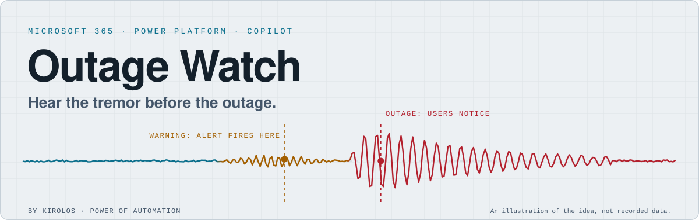
</picture>

**Early-warning monitoring for Microsoft 365, Power Platform and Copilot.**
It checks 36 to 37 services from the outside, learns what normal looks like for each one,
and sends a detailed alert to Teams, Slack or Webex when something fails. It deploys from a single command.


[The 30-second version](#the-30-second-version) &nbsp;·&nbsp; [Quick start](#quick-start) &nbsp;·&nbsp; [What it does](#what-it-does) &nbsp;·&nbsp; [Lessons learned](#lessons-learned) &nbsp;·&nbsp; [FAQ](#faq) &nbsp;·&nbsp; [Honest limits](#what-is-proven-and-what-is-not)

<br>

**Created by Kirolos · Power of Automation**

[](https://www.linkedin.com/search/results/people/?keywords=Kirolos%20Power%20of%20Automation)

<br>

<picture>
  <source media="(prefers-color-scheme: dark)" srcset="docs/img/facts-dark.svg">
  <source media="(prefers-color-scheme: light)" srcset="docs/img/facts-light.svg">
  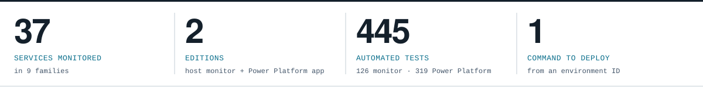
</picture>

</div>

<!-- When the case study is published, link it here: [Read the case study](URL) -->

## The 30-second version

| Topic | In short |
|---|---|
| **Problem** | In 2026, Microsoft 365 and Outlook had several outages. Status pages lagged, and monitoring inside the affected cloud can fail with it. Many teams first heard from a phone call. |
| **What I built** | A monitor in two editions. A **host edition** runs outside Microsoft 365 as an independent witness. A **Power Platform edition** runs in your tenant with Dataverse, three Power Automate flows and a React code app. |
| **How I proved it** | 445 automated tests, a live run against real Microsoft endpoints, a deployment onto a real Power Platform tenant, and an audit of my own alert logic that found and fixed five defects. |
| **What is next** | Real alert delivery tests with Slack and Webex, signed-in SharePoint and OneDrive checks, digests and maintenance windows. See [the limits](#what-is-proven-and-what-is-not). |

## Why this exists

Microsoft 365 and Outlook had several outages in 2026. For many companies the first sign was a phone call from a user.

| Date (2026) | What was reported | Reported cause |
|---|---|---|
| 🔴 Jan 22 to 23 | Microsoft 365, many services, nearly ten hours | Load during a maintenance window plus a third-party network provider problem ([The Register](https://www.theregister.com/2026/01/23/microsoft_365_outage/)) |
| 🔴 Mar 16 | Exchange Online mailbox access | Supporting network infrastructure ([National CIO Review](https://nationalcioreview.com/articles-insights/extra-bytes/breaking-microsoft-exchange-online-outage-disrupts-outlook-email/)) |
| 🔴 Aug 31 | Outlook and sign-in | Preliminary: an issue in a core authentication configuration shared by several services ([Tom's Guide](https://www.tomsguide.com/au/news/live/microsoft-outlook-outage-august-31-2026)) |
| 🟠 Nov 6 and 9 | Mail to Outlook.com, and Outlook on the web in EMEA | Smaller incidents, both marked resolved |

> Causes are as reported at the time. Several were preliminary, and Microsoft's final reports may differ.

Outage Watch starts from one rule: **ask the services yourself, from somewhere that does not depend on the thing that might be failing.**

## Break something

The interactive version is in the case study. These are the same rules and the same numbers, from the real dependency data in the app (37 services).

| You make this fail | What the map marks | Why |
|---|---|---|
| **Sign-in (`auth`)** | **31 at risk**, 5 still answering | 31 services need sign-in. The 5 that keep answering are CDNs and independent services. |
| **Exchange** | **3 Copilot services at risk** | Copilot reads mail, so it is at risk when Exchange fails. |
| **`teams-cdn`** | Nothing at risk | A content network that nothing else depends on. |

<div align="center">

&nbsp;
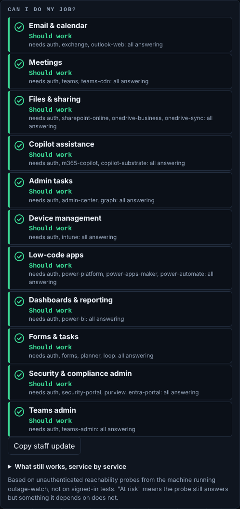
<br><sub>Host edition: a simulated sign-in outage and the staff-language task view. Demo data.</sub>
</div>

## What it does

Each row says how far it has been proven. **Live** means real probes against real endpoints. **Simulated** means failure behaviour shown with demo data. **Mock** means tested against a simulator only.

| | Feature | Proof |
|---|---|---|
| 🔍 | **Early warning, not just up or down.** Learns each service's normal speed and flags a slowdown before it fails. Five states: `up`, `warning`, `suspect`, `down`, `blocked`. | Live probes |
| 🗺️ | **Blast-radius map.** Draws the chain from sign-in to every service and to Copilot, and shows a failure spreading along it. | Simulated failures |
| 🚨 | **Alerts to Teams, Slack and Webex.** One message per round, grouped by family, with the real error text. Opening, reminder and recovery messages, snooze, and a probable common cause. | Mock |
| ✅ | **Admin "send test notification".** One button posts a labelled live status message to the channels you pick and shows what each returned. | Mock |
| 🤖 | **CI gate and agent API.** Pipelines stop themselves during an incident. An OpenAPI file lets an AI agent ask about service health. | Not run in a real pipeline |
| 📋 | **Incidents and post-incident reports.** Records when each incident began and ended, what failed and the worst error. Exports a Markdown report and drafts a staff update. | Demo data |
| 🙋 | **"Can I do my job?" for staff.** Turns probe results into plain tasks such as email, meetings and files, with a calm update that never guesses Microsoft's root cause. | Live data |
| 🚀 | **Zero-touch deployment.** Give an environment ID. The script creates tables, flows and the app, and finds your SharePoint tenant name itself. | Deployed on a real tenant |
| 🔗 | **Tamper-evident log and fire drills** (host edition). Every log record is chained so an edit shows up. Outage rehearsals with a timed checklist. | Unit tested |

<details>
<summary><b>Detection: early warning, not just up or down</b></summary>

- Probes public, unauthenticated endpoints for **sign-in, Exchange, Teams, SharePoint and OneDrive, Power Platform and Power BI, Office on the web, security and compliance, and Copilot**.
- Learns each service's own normal speed. When a service answers at three times that baseline (and at least 800 ms slower) it turns to **warning** while it is still up.
- **Blip filtering:** one failed probe is `suspect`, two in a row is `down`.
- **`blocked` is not `down`:** your own proxy or firewall refusing a probe is reported separately, so a locked-down office never raises a false freeze.
- Services that need your tenant name (SharePoint, OneDrive) show as *not set up*, never as failures.
</details>

<details>
<summary><b>Dashboard: the map, insights and the staff view</b></summary>

- State is shown by shape, icon and text, never colour alone.
- **Probable common cause:** when many services fail together it names the shared dependency, shows the evidence, and says what the probes cannot know.
- **Insights:** drift, flapping services, repeat offenders, a reliability scorecard, alert-noise counts and a post-incident report you can copy or download.
- Light and dark themes, phone layouts, and a clearly labelled **simulation mode** so every state can be demoed without an outage.
</details>

<details>
<summary><b>Alerts: Teams, Slack and Webex with the real error</b></summary>

- One message per round, **grouped by family**, with the real error text, URL, HTTP status and timing.
- Opening, reminder and recovery messages, snooze, and a deliberate **"probing stopped"** notice if the probes go silent.
- Per-channel limits counted in bytes, with a visible "message shortened" footer. Mentions and markup in probe data are neutralised.
- A warning when an alert channel is hosted on Microsoft 365, because it can fail in the same outage.

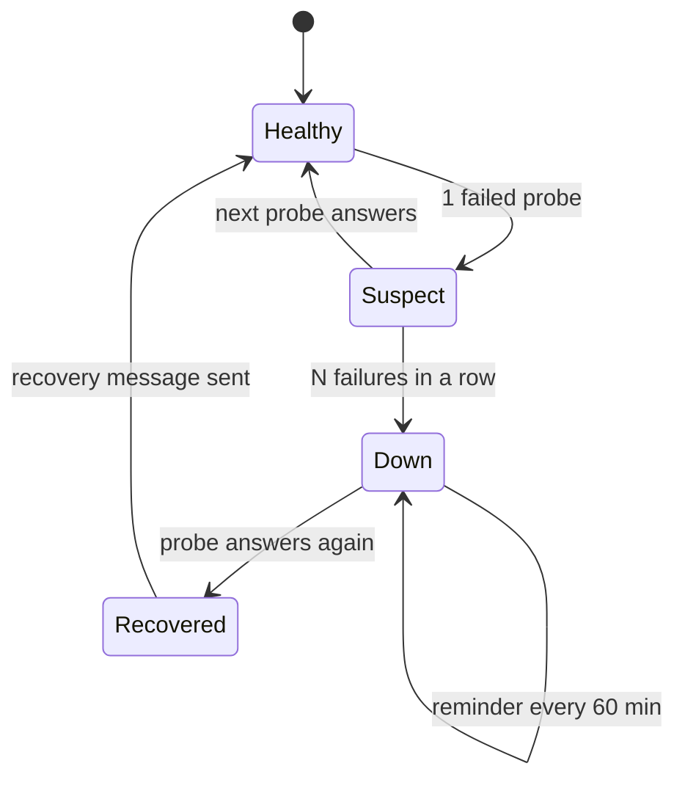
</details>

<details>
<summary><b>Automation: CI gate, agent API, incidents and drills</b></summary>

- A **machine-readable "safe to change?" answer** (`ok` / `caution` / `freeze`) with ready-made gate steps for GitHub Actions, Azure DevOps and PowerShell.
- An **OpenAPI definition** so an AI agent can ask about service health (unconfirmed in Copilot Studio).
- Host edition: **fire drills** that rehearse the 2026 outage patterns with a timed checklist, a **tamper-evident hash-chained log** (`report.py --verify`), uptime and SLA reports, maintenance windows and a dead-man's-switch heartbeat.
</details>

<details>
<summary><b>Deployment: zero-touch, idempotent, with rollback</b></summary>

- The script checks prerequisites, creates what is missing, runs its own tests, starts the service and smoke-tests it.
- **Re-running is an upgrade.** Tokens, config, data and history are kept. A failed run says what it left behind.
- The Power Platform script **finds your SharePoint tenant name itself** (Azure sign-in, then Microsoft Graph), then verifies the address answers before seeding it. It never seeds a host it has not seen answer.
- Webhook URLs come from a hidden prompt or an environment variable, never the command line, and are never printed, logged or shown on screen.
</details>

## See it

<div align="center">
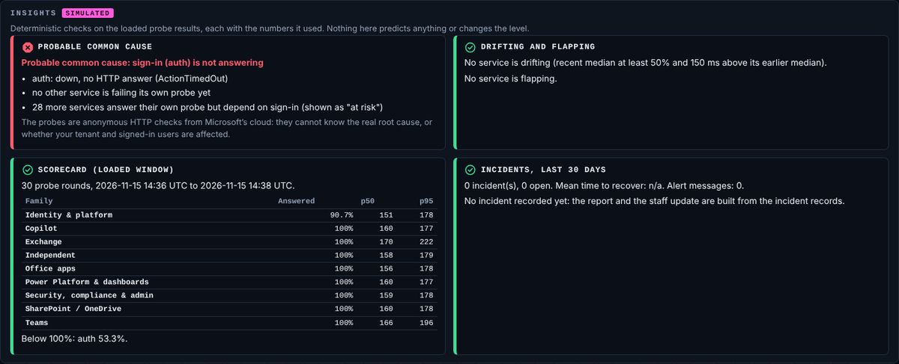
<br><sub>Power Platform edition: a simulated sign-in outage. The panel names the probable common cause, shows the evidence, and says what the probes cannot know.</sub>
<br><br>
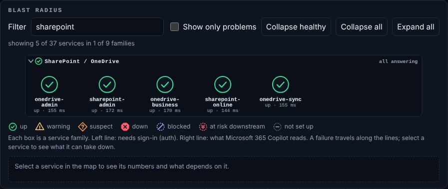
&nbsp;
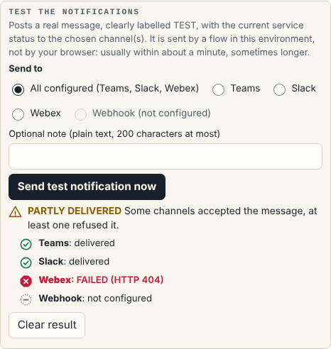
<br><sub>The SharePoint and OneDrive family, and the admin test-notification panel with one failing channel (demo data).</sub>
<br><br>
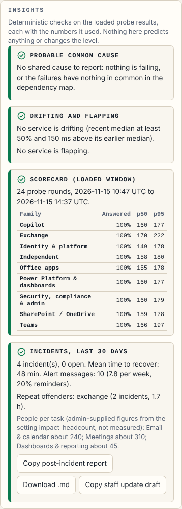
<br><sub>On a phone: incident history and the post-incident report (demo data).</sub>
</div>

## Architecture

**Power Platform edition** (runs in your tenant, 10-minute interval):

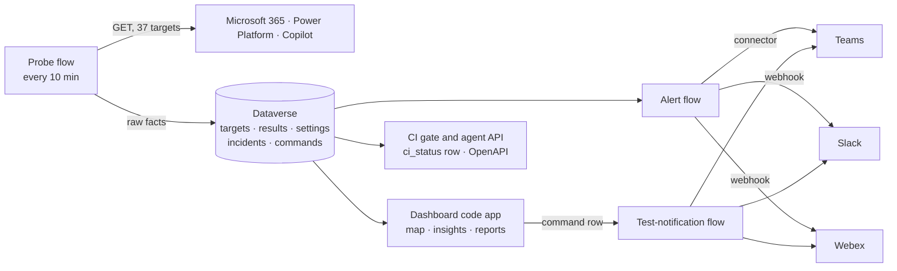

**Host edition** (runs outside Microsoft 365 as the independent witness, 60-second interval):

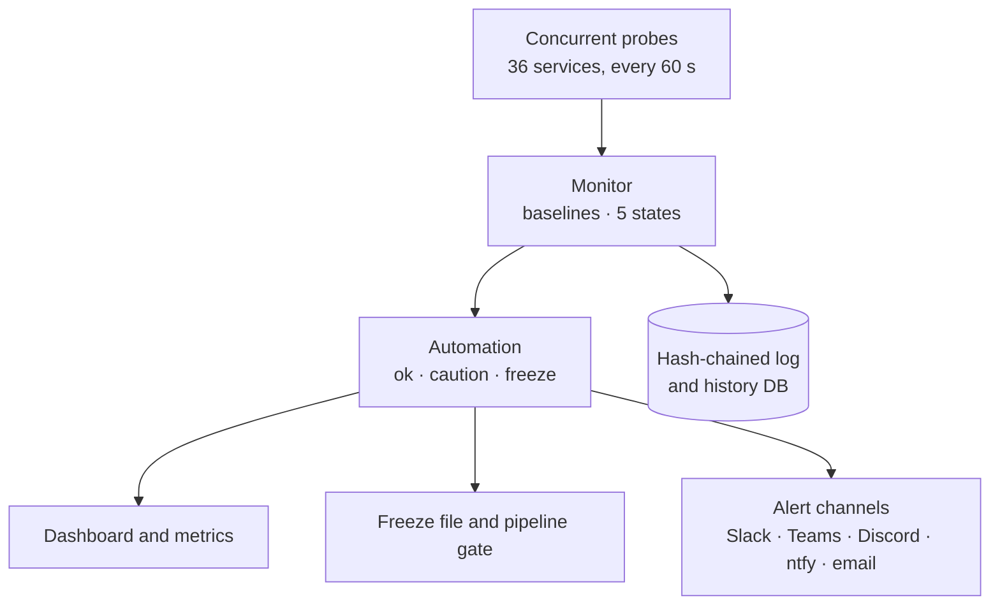

**The dependency model** both editions share:

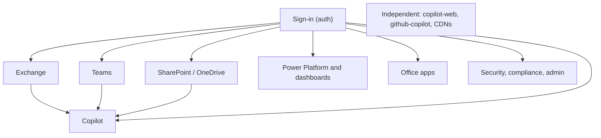

> **Why two editions?** A flow inside Microsoft's cloud can fail with it. The host edition runs outside as the independent witness. The Power Platform edition is the convenient in-tenant view. **Run both.**

## Quick start

Always start with a dry run. Replace the zeros with your Power Platform environment ID (the part after `/environments/` in the maker portal URL).

<details open>
<summary><b>Power Platform edition</b></summary>

```bat
cd outage-watch-powerplatform
Deploy-OutageWatchPP.cmd 00000000-0000-0000-0000-000000000000 -DryRun
Deploy-OutageWatchPP.cmd 00000000-0000-0000-0000-000000000000
```

Needs a Dataverse environment with code apps enabled, Power Automate Premium for the flow owner and Power Apps Premium for dashboard viewers.
The script asks which alert channels to set up. Teams takes a channel link ("Get link to channel" in Teams). Slack and Webex take an incoming-webhook URL with hidden input.
Add `-SendTestAlert` afterwards to post a labelled TEST message to every channel. Details: [`outage-watch-powerplatform/README.md`](outage-watch-powerplatform/README.md).
</details>

<details>
<summary><b>Host edition on Windows</b></summary>

```bat
cd outage-watch-package
Deploy.cmd 00000000-0000-0000-0000-000000000000 -Yes -Tenant contoso
```

Needs Python 3.9+ for all users and administrator rights. It runs as a start-at-boot scheduled task and listens on `127.0.0.1` only. Details: [`outage-watch-package/README-DEPLOY.txt`](outage-watch-package/README-DEPLOY.txt).
</details>

<details>
<summary><b>Host edition on Linux or macOS, or just run it</b></summary>

```bash
cd outage-watch
./deploy/deploy.sh --env-id 00000000-0000-0000-0000-000000000000 --dry-run
./deploy/deploy.sh --env-id 00000000-0000-0000-0000-000000000000 --yes

# or without installing anything:
python3 outagewatch.py --serve 8080 --tenant contoso
```

The monitor has no dependencies beyond Python's standard library. Details: [`outage-watch/README.md`](outage-watch/README.md).
</details>

<details>
<summary><b>Tenant name for SharePoint and OneDrive</b></summary>

SharePoint hosts are named after your tenant's original `onmicrosoft.com` domain. The Power Platform script detects it. If detection fails it tells you the exact flag to add:

```bat
Deploy-OutageWatchPP.cmd <environment-id> -TenantName contoso
```
</details>

## What this shows I can do

Each row names the evidence in the project, so you can check it.

| Skill | What it looks like here | Evidence |
|---|---|---|
| **Power Platform engineering** | Dataverse tables and solutions, Power Automate flows, connection references and a React code app, provisioned by script | Three flows, five tables, upgrade tested from the deployed state |
| **Microsoft 365 and identity** | Service dependencies across sign-in, Exchange, Teams, SharePoint, OneDrive and Copilot. Tenant discovery with Entra and Graph | A 37-service dependency map and a verified tenant-name detector |
| **Reliability and incident response** | Baselines, confirmation rules, alert deduplication, incident records, post-incident reports, fire drills | Five alert-logic defects found by my own audit and fixed with tests |
| **Automation and CI/CD** | One-command deployment, pipeline gates for GitHub Actions and Azure DevOps, an agent-readable API definition | Idempotent re-runs, rollback on failure, 84 deploy-script checks |
| **Security** | Strict input validation, secrets kept out of tables, logs and screens, admin-only controls, a strict content policy | Hostile-input tests for IDs, tenant names and message text |
| **Quality engineering** | Golden tests against a reference implementation, a workflow-language interpreter for the flows, a simulator that enforces real column limits | 445 unit tests and three bugs found on the first real deployment |
| **Front end and accessibility** | React and TypeScript, light and dark themes, phone layouts, state shown with shape and text as well as colour | Checked at 360, 390 and 412 px with no sideways scrolling |
| **Working with AI** | Claude Code as a pair programmer. I set the requirements, reviewed the work and re-ran every check myself | Each handoff verified from a clean unzip before I shipped it |

## Decisions and trade-offs

| Decision | Why |
|---|---|
| **A 10-minute interval, not 5** | At 5 minutes the alert logic would use 98% of a Premium licence's 40,000 daily requests. At 10 minutes the default design uses about half. Detection is slower, and the app says so. |
| **Analysis in the browser** | Common-cause detection, drift, flapping and the scorecard run in the dashboard, so they cost no extra flow runs. |
| **Two editions on purpose** | A flow inside Microsoft's cloud can fail with it. The host edition runs outside as the independent witness. |
| **Secrets stay out of tables** | Webhook URLs come from a hidden prompt or an environment variable and live only inside the flow definition. The docs state who can read them there. |
| **Never guess a host** | The tenant-name detector checks that the address answers, refuses if two candidates answer, and rejects a 404 answer, so a wrong host is never seeded. |
| **Say "probable", not "root cause"** | Microsoft's early causes are often preliminary and revised. The app shows what the probes saw and says what they cannot know. |

## What broke, and what I learned

### Three bugs on the first real deployment

Every simulated test passed. The first run on a real tenant still found three problems in a row. Each fix came with a test that catches the whole class.

| | What the real service did | The fix |
|---|---|---|
| 1 | Rejected a column change that arrived right after its table was created | Wait for the table, check whether the change landed anyway, retry only that error |
| 2 | Said a column did not exist, because its API cache lagged a successful change | Wait until every new column is readable before seeding any data |
| 3 | Refused a 618-character setting in a 400-character column | Check every written value against its column, and make the simulator enforce limits like the real service |

### Five defects my own audit found in the alert logic

| | Severity | Defect | Fix |
|---|---|---|---|
| D1 | High | Alert state was saved before posting, so if every channel failed the event was lost | State is kept only if a channel accepted the message, otherwise rolled back and re-announced |
| D7 | High | If the probe flow stopped, the alert flow stayed silent | One "PROBING STOPPED" notice per stale period |
| D9 | High | A missing result row counted as recovered | Treated as unknown |
| D8 | Medium | A target disabled mid-incident was announced as "answering again" | Now says "no longer monitored" |
| D2 | Medium | Size caps counted characters and cut silently | Byte-safe caps with a visible "message shortened" footer |

## Lessons learned

| # | Lesson | What happened | What I do now |
|---|---|---|---|
| 1 | **A simulator proves your assumptions agree with each other.** | Every test passed, then a real tenant found three bugs in a row. | Treat the first real run as a test of the simulator, and feed each finding back into it. |
| 2 | **Test limits you do not think about.** | A 618-character value broke a 400-character column. | Every written value is checked against its column, and the simulator enforces the same limit. |
| 3 | **Caches lag, so wait for readiness.** | The API said a column was missing right after creating it. | Poll until the thing is readable. Do not sleep for a fixed time. |
| 4 | **Retry only errors you understand, and check first.** | A vague error hid a change that had already succeeded. | Check whether the change landed before retrying, so a retry can never duplicate it. |
| 5 | **Save state after you know the outcome.** | An alert was marked as sent before any channel accepted it. | Persist alert state only after at least one delivery succeeded. |
| 6 | **Absence is a signal.** | A missing row looked like recovery, and a stopped flow looked like calm. | Missing data is unknown, and silence gets its own notice. |
| 7 | **Be honest about what you cannot know.** | Microsoft's early causes were preliminary and later revised. | The app says "probable common cause", shows the evidence, and states what the probes cannot know. |
| 8 | **Monitoring inside the cloud shares its fate.** | A flow in Microsoft's cloud fails with it. | A host edition outside as the independent witness, and an outside heartbeat. |
| 9 | **Count quotas before you design.** | At 5 minutes the design would use 98% of the daily request limit. | A 10-minute default, and analysis done in the browser instead of extra flow runs. |
| 10 | **Make "not configured" impossible to miss.** | A deployment ran fine but no alerts existed, and nothing said so. | The summary ends with a loud **ALERTS ARE OFF** block and the exact command to fix it. |
| 11 | **Never guess an address.** | A wrong tenant name would seed a wrong SharePoint host. | Detect, verify that it answers, refuse on ambiguity or a 404, and say how to override. |
| 12 | **Do not trust a handoff, verify it.** | Work from AI helpers arrived with confident reports. | Re-run the tests, the build and a live check from a clean unzip before shipping. |

## Features I could not find elsewhere

I read through Uptime Kuma's issue tracker, StatusGator, IsDown, Better Stack, Microsoft's own monitoring pages and the public pages of Microsoft 365 monitoring vendors. I did not find a dependency map that includes Copilot, a "can I do my job" view for staff, built-in outage fire drills, a check that your alert channel can fail with the outage, or a free one-command Power Platform edition.
Not finding something does not prove nobody built it, so check before you rely on this.

## What is proven and what is not

| Area | Status |
|---|---|
| Live probes of the Microsoft 365 and Copilot endpoints | **Run live**: all 36 services answered in one round |
| Power Platform probe flow and dashboard | **Deployed on a real tenant** by the author |
| Alert flow, Teams, Slack and Webex delivery, test button, CI snippets, tenant auto-detect | **Tested against a simulator and a workflow-language interpreter only.** Not yet delivered to a real channel |
| Slack and Webex message limits | Written from memory. Not yet checked against their docs |
| Failure behaviour (`warning`, `down`, `freeze`) | Exercised in simulation and tests. **Never watched a real Microsoft outage** |
| PowerShell scripts | Statically checked. The Power Platform script has run on a real tenant. The Windows host script has not been run on Windows by its author |

### What it cannot do yet

- It checks that services answer and how fast. It does not sign in and open a file, send a mail or join a meeting.
- The Power Platform edition shares a cloud with the services it watches.
- Not built yet: signed-in SharePoint and OneDrive checks, scheduled digests, maintenance windows and escalation in the Power Platform edition, and a security role for the test button.

### Roadmap

- [ ] Deliver a real test message to Teams, Slack and Webex and record the result
- [ ] Check Slack and Webex payload formats and limits against their documentation
- [ ] Signed-in SharePoint and OneDrive checks (opt-in)
- [ ] Digest, maintenance windows and escalation in the Power Platform edition
- [ ] Authenticated mail send-and-receive check
- [ ] Watch a real outage and compare detection time with Microsoft's own reports

## FAQ

<details>
<summary><b>Do I need a webhook URL for Teams?</b></summary>

No. Teams uses a Power Automate connector, and the channel link tells the flow where to post. Click **Create** once on the Teams connection when the script opens the connections page. Slack and Webex are different: they use incoming-webhook URLs, which the script asks for with hidden input.
</details>

<details>
<summary><b>What does it cost to run?</b></summary>

The host edition is free to run and needs a machine. The Power Platform edition needs **Power Automate Premium** for the flow owner (the HTTP action is a premium connector) and **Power Apps Premium** for dashboard viewers. The default design uses about 19,584 of the 40,000 daily requests (49%), or about 52% with SharePoint included.
</details>

<details>
<summary><b>Does it replace Microsoft Service Health?</b></summary>

No. It is an independent second view that asks the services itself. The host edition has an optional check that flags when your probes see trouble but Microsoft's status still says healthy. That check has only been tested against a mock.
</details>

<details>
<summary><b>Does it sign in, send a mail or open a file?</b></summary>

No. It sends anonymous requests to public endpoints and measures whether the service answers and how fast. A service can answer its front door and still be broken behind the login. Signed-in checks are on the roadmap.
</details>

<details>
<summary><b>What is the difference between <code>blocked</code> and <code>down</code>?</b></summary>

`down` means a service stopped answering. `blocked` means your own proxy or firewall refused the probe, which says nothing about Microsoft. Keeping them apart stops a locked-down office network from raising a false freeze.
</details>

<details>
<summary><b>Why does the Power Platform edition probe every 10 minutes?</b></summary>

Quota. Microsoft counts every flow action as a request, and a Premium user gets 40,000 a day. At 5 minutes the design would use 98% of that, so the default is 10 minutes. The cost is slower detection: an outage is confirmed after up to about 20 minutes. The host edition probes every 60 seconds.
</details>

<details>
<summary><b>Why two editions?</b></summary>

A flow running inside Microsoft's cloud can fail with the cloud it watches. The host edition runs outside Microsoft 365 as the independent witness, and the Power Platform edition is the convenient view where your admins already work. Run both if you can.
</details>

<details>
<summary><b>Does it send data anywhere?</b></summary>

There is no analytics or telemetry code in either edition. The only outbound requests are the probes to Microsoft endpoints, the alert channels you configure, and an optional heartbeat URL you provide.
</details>

<details>
<summary><b>How are webhook URLs and tokens protected?</b></summary>

Webhook URLs come from a hidden prompt or an environment variable. They are never command-line values, never printed or logged, never stored in Dataverse tables and never shown on screen. In the Power Platform edition they live only inside the flow definition, where flow owners and administrators can read them. The docs say so plainly. The host edition keeps its admin token in a file that only administrators and the service can read.
</details>

<details>
<summary><b>Can I add my own services to monitor?</b></summary>

In the host edition, yes: a config file adds or replaces targets (see `outage-watch/config.example.json`). In the Power Platform edition, targets live in a Dataverse table, but adding your own rows is not documented or tested yet, so treat it as unsupported for now.
</details>

<details>
<summary><b>Does it work in GCC High, DoD or China clouds?</b></summary>

Not yet. It is built for the commercial cloud. The Power Platform script recognises the sovereign clouds from the environment URL and reports "not supported yet" instead of seeding a wrong SharePoint host.
</details>

<details>
<summary><b>How do I test the alerts without an outage?</b></summary>

In the Power Platform dashboard, press **Send test notification now**, or run the deploy script with `-SendTestAlert`. Both post a clearly labelled TEST message with the current service status to the channels you choose, and show what each one returned. In the host edition use `--test-alert`.
</details>

<details>
<summary><b>I deployed it and I do not see any alerts. Why?</b></summary>

The alert flow and the Teams connection are only created when you give the script at least one channel. If you skipped that step, the deploy summary ends with an **ALERTS ARE OFF** block and the exact command to run. Re-running the deploy with a channel is safe and creates nothing twice.
</details>

<details>
<summary><b>Is re-running the deploy safe? How do I undo it?</b></summary>

Yes. Every step reads first and creates only what is missing, so a re-run is an upgrade. Use `-DryRun` to see the plan. To remove it, run `Uninstall-OutageWatchPP.cmd <environment-id>` (the flows are removed and the data stays) and add `-Purge` to delete the tables and all results too. The Windows host package has an `Uninstall.cmd` with the same `-Purge` option.
</details>

<details>
<summary><b>Is this AI?</b></summary>

The monitoring logic is deterministic and shows its evidence. There is no model deciding anything at run time. The project was built with Claude Code as an AI pair programmer, and every handoff was checked by re-running tests, builds and live checks.
</details>

<details>
<summary><b>Has it caught a real outage?</b></summary>

No. Failure behaviour has been exercised in simulation and tests, and the probes have run live against healthy services. The roadmap includes watching a real outage and comparing detection time with Microsoft's own reports.
</details>

<details>
<summary><b>Why 36 services in one edition and 37 in the other?</b></summary>

The Power Platform edition adds the SharePoint admin center as an extra target. SharePoint Online and OneDrive for Business need your tenant name in both editions, so they appear as *not set up* until it is known.
</details>

<details>
<summary><b>What is the licence?</b></summary>

None has been chosen yet, so all rights are reserved until one is added.
</details>

## Repository map

```text
.
├── outage-watch-powerplatform/   Power Platform edition: Dataverse, 3 flows, React code app,
│                                 zero-touch deploy script, CI gate, agent OpenAPI, 319 tests
├── outage-watch/                 Host monitor (Python, standard library only), dashboard,
│                                 alerts, reports, Docker and systemd files, deploy.sh, 126 tests
├── outage-watch-package/         Windows zero-touch package: Deploy.cmd, PowerShell script, installer
├── docs/
│   ├── img/                      Banner, stat strip and screenshots used in this README
│   └── ownership-command-center.md   Docs for the separate Ownership Command Center app
├── src/ · scripts/ · Deploy.cmd  The Ownership Command Center code app and its deploy script
└── .github/workflows/            Test workflow for the host monitor
```

> The repository also contains **Ownership Command Center**, a separate Power Apps code app that transfers ownership of apps, flows and agents. Its documentation is in [`docs/ownership-command-center.md`](docs/ownership-command-center.md).

## Built with AI, verified by hand

Outage Watch was built with **Claude Code** as an AI pair programmer. The author set the requirements, reviewed the work and re-ran every check, including a clean-unzip install and test run for each handoff. Every claim above is backed by a test or a real run, and the limits are listed.

---

<div align="center">

### Let's talk about Microsoft 365 and Power Platform reliability

If you run Microsoft 365 or Power Platform and an outage has ever reached you through a phone call, I would like to hear what your monitoring missed.

**Kirolos · Power of Automation**

[](https://www.linkedin.com/search/results/people/?keywords=Kirolos%20Power%20of%20Automation)

<sub>The button opens LinkedIn. You send the connection request from there.</sub>

</div>
