<div align="center">

# ⚡ PNC SharePoint Team — Explorer

### Connect **any SharePoint list or library** with one click — dashboards, approvals, e-mail and an **AI assistant** that talks to your **Copilot Studio agents** (classic *and* new experience).


**Created by Kirolos — Power of Automation**

[](https://www.linkedin.com/in/kirolos-erian-39014349/)

</div>

---

## 🎬 One-minute tour

<div align="center">

<a href="docs/marketing/sharepoint-explorer-marketing.mp4"></a>

<sub>▶ Click the animation for the full-quality MP4 (<code>docs/marketing/sharepoint-explorer-marketing.mp4</code>). Source of the video: <code>docs/marketing/index.html</code> — all frames use demo data only.</sub>

</div>

> **Images or video not showing?** They are loaded from the `docs/` folder next to this README. Keep the folder structure when you copy the README (or open it from the unzipped package / the repository on GitHub); a README opened on its own cannot show them.

---

## 📑 Contents
0. [One-minute tour](#-one-minute-tour)
1. [Feature showcase](#-feature-showcase)
2. [Screens](#-screens)
3. [How it works](#-how-it-works)
4. [Requirements](#-requirements)
5. [Quick start (15 minutes)](#-quick-start-15-minutes)
6. [AI assistant — pick your agent type](#-ai-assistant--pick-your-agent-type)
7. [Classic Copilot Studio agents](#-classic-copilot-studio-agents-no-extra-setup)
8. [New-experience agents (admin setup)](#-new-experience-agents-custom-connector--app-registration)
9. [The Swagger (OpenAPI) file](#-the-swagger-openapi-file)
10. [**Developer guide — from scratch, step by step**](#-developer-guide--from-scratch-step-by-step)
11. [Authentication & URL reference](#-authentication--url-reference)
12. [Security & privacy checklist](#-security--privacy-checklist)
13. [FAQ & troubleshooting](#-faq--troubleshooting)
14. [Full feature reference](#-full-feature-reference)

---

## ✨ Feature showcase

<table>
<tr><td width="33%" valign="top">

### 🔌 Connect & explore
* Any **site → list or library → Connect**
* Several sources, switch from the header
* Grid, **card**, **board** and **calendar** views
* Libraries: folders, file types, storage, largest files
* **Millions of rows**: virtualised grid, keyset paging, server-side search
* Saved **views**, favourites, share links, record page

</td><td width="33%" valign="top">

### 📊 Dashboards
* **Auto-built** KPIs, timeline, breakdowns, data health, insights
* **Admin designer**: number · gauge · bar · donut · timeline · top-N · note
* Per-widget filters, click-through to items
* Live pulse (new/changed items), **Dashboard PDF**
* Deep scan of the whole list without freezing

</td><td width="33%" valign="top">

### ✅ Approvals
* **Multi-layer** workflows per list/library
* **Automatic** start on create/modify with criteria
* Conditional layers, escalation, delegation, bulk actions
* Approval tag in the grid, step tracker, full **history** + audit CSV
* Notify approvers by prefilled e-mail

</td></tr>
<tr><td valign="top">

### 🤖 AI assistant
* **Copilot Studio agents inside the app** — classic *and* new experience
* Agent **drop-down** from your environment
* Sends the current list, filters and selection as context
* Agent Builder / M365 Copilot agents as one-click links
* Step-by-step **Test connection** diagnostics

</td><td valign="top">

### ✏️ Work faster
* **Inline editing** (Excel-style, undo)
* **Colour rules** (conditional formatting)
* Forms generated from the schema, tabs for long forms
* **Import CSV**, duplicate, favourites
* **Search everywhere** (Ctrl+K), command palette

</td><td valign="top">

### 📤 Share & export
* CSV (formula-safe), JSON, PDF
* **Streaming export** of everything matching
* **E-mail files/folders** (Outlook web, mailto, copy, `.eml`)
* Roles from SharePoint permissions: reader · contributor · data admin
* Manage access and sharing from the item panel

</td></tr>
<tr><td valign="top">

### 🛡️ Production-grade
* Request **circuit breaker**, memory **watchdog**
* **Safe mode** + auto-recovery, no white-page loops
* Error log ring buffer, blank-page overlay
* Hard caps (40,000 rows in memory) with clear messages

</td><td valign="top">

### ♿ Accessible
* Light / dark / **high-contrast** / system themes
* Fully keyboard-operable grid
* ARIA roles, focus trap, reduced motion
* **axe-core: 0 violations**

</td><td valign="top">

### 🚀 Zero-touch deploy
* `Deploy.cmd` installs Node + `pac`, wires connectors, builds, publishes
* Updates the same app on re-run
* Owners baked into the bundle
* `Run-Demo.cmd` — try everything with sample data

</td></tr>
</table>

---

## 🖼️ Screens

> All images use the built-in **demo data** or **sample values** — no real tenant, site, user or agent information.

<div align="center">


<sub>Animated layout preview — open <code>docs/app-layout-demo.svg</code> in a browser to replay.</sub>

</div>

| | |
|---|---|
| **Dashboard** — auto-built KPIs, charts, insights<br>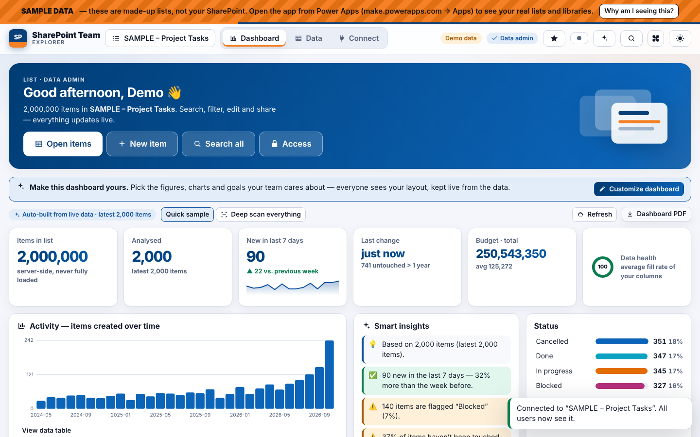 | **Connect** — any site, list or library<br>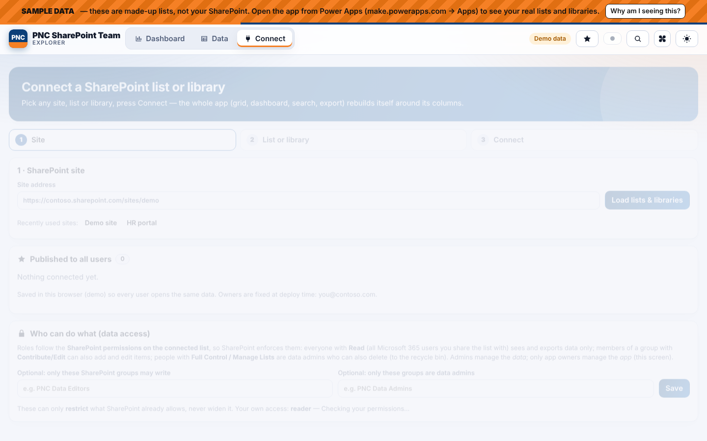 |
| **Data grid** — virtualised, inline edit, filters<br>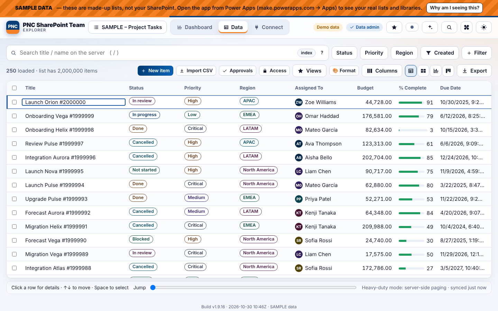 | **Item details** — actions, approvals, history<br>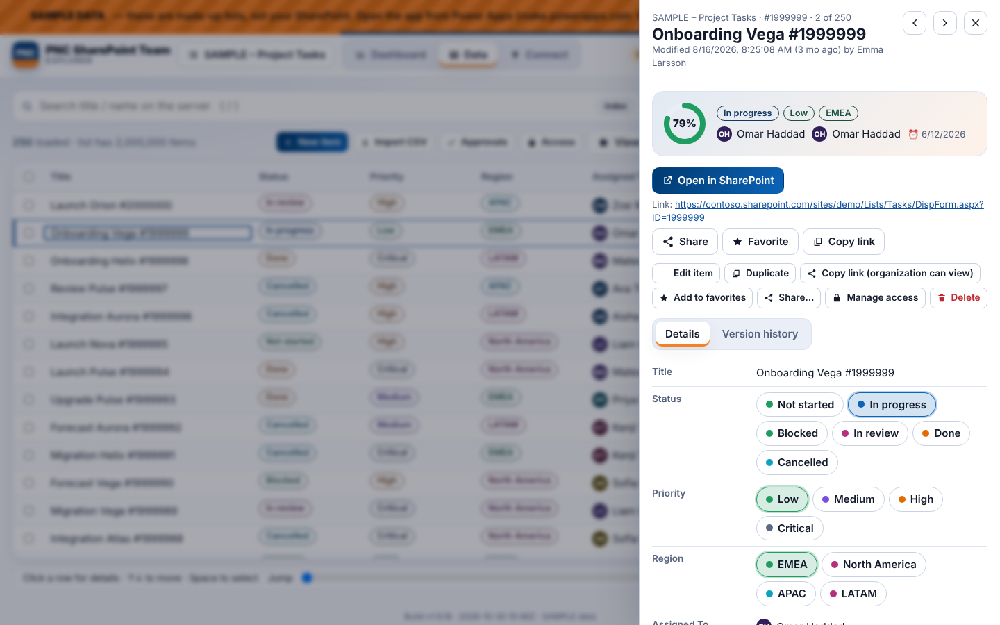 |
| **New item** — generated from the schema<br>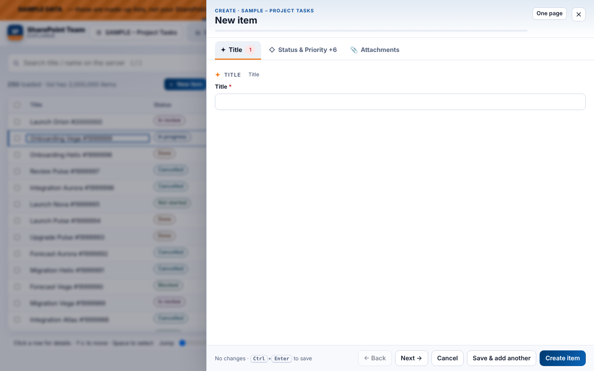 | **Board view**<br>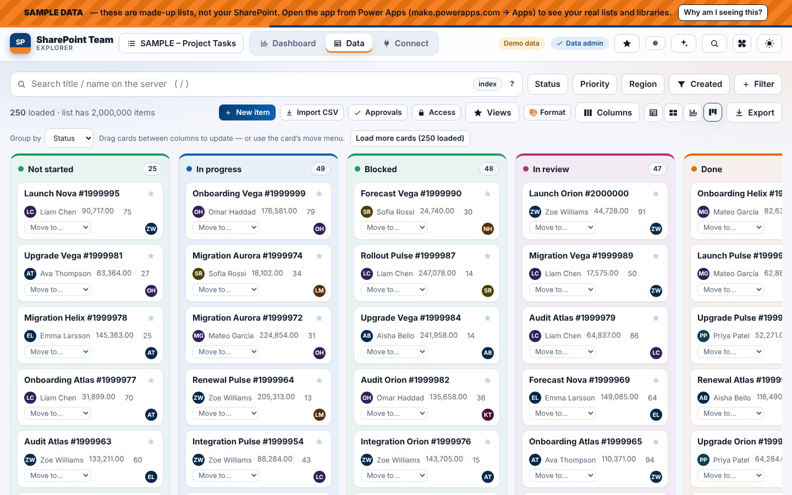 |
| **Dashboard designer** (admins)<br>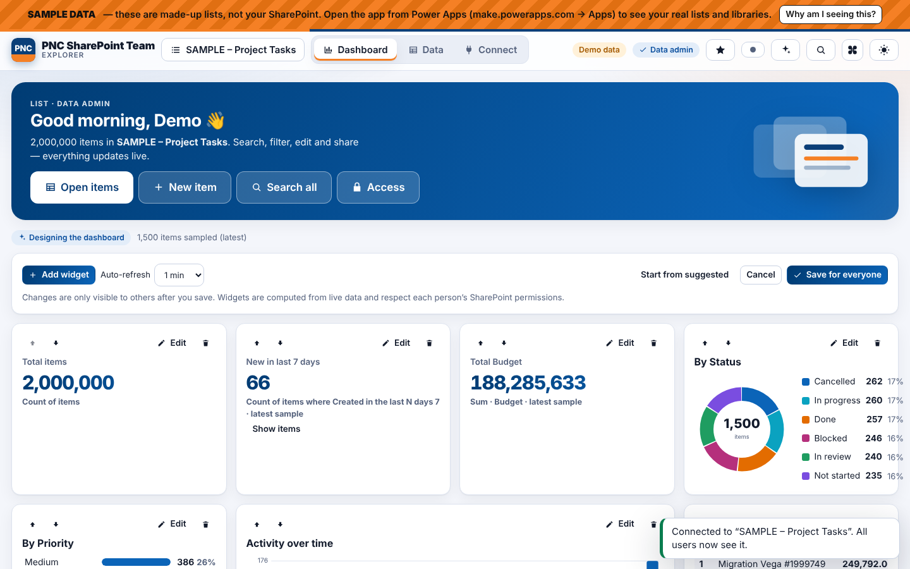 | **Approval workflow designer**<br>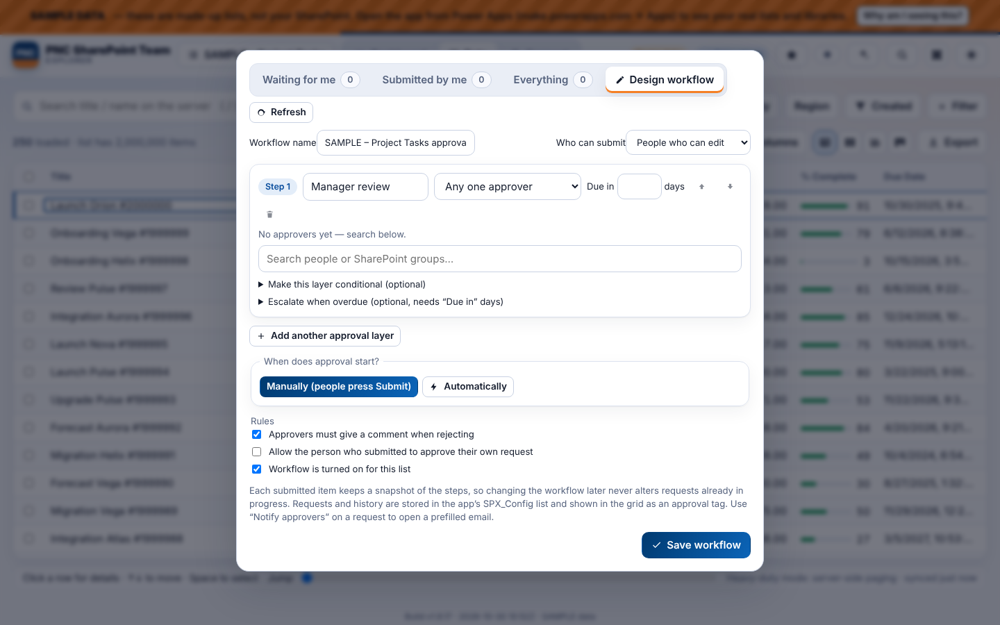 |
| **Add an agent** — pick, test, save<br>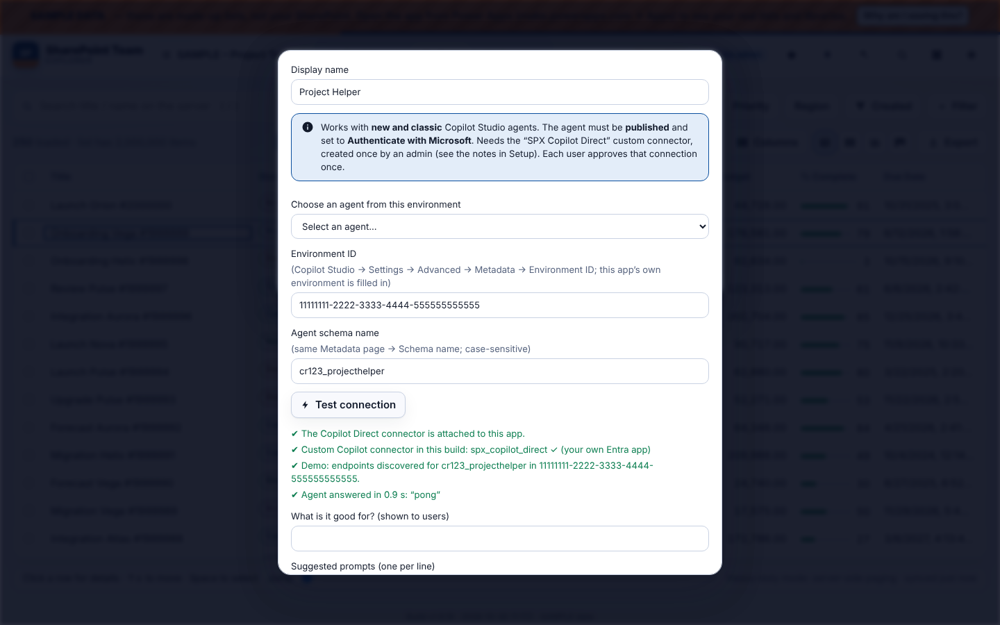 | **Chat with the agent** — list context included<br>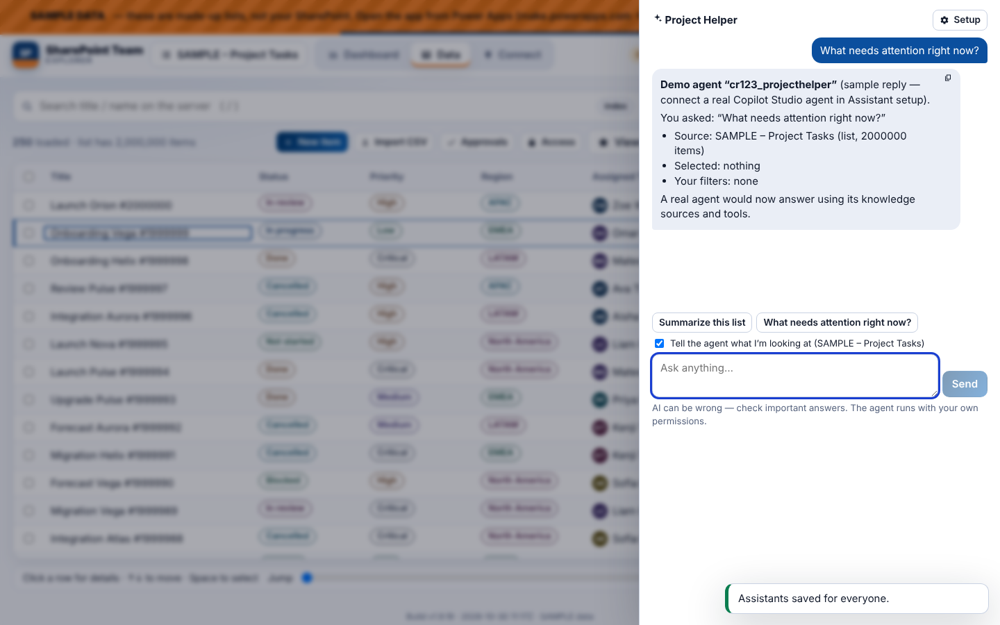 |
| **Entra redirect URIs** (sample values)<br>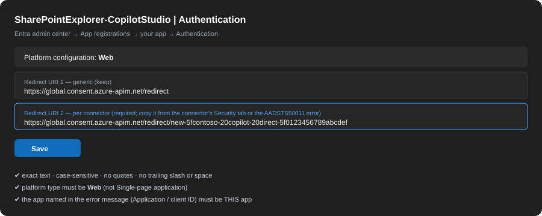 | **Connector security tab** (sample values)<br>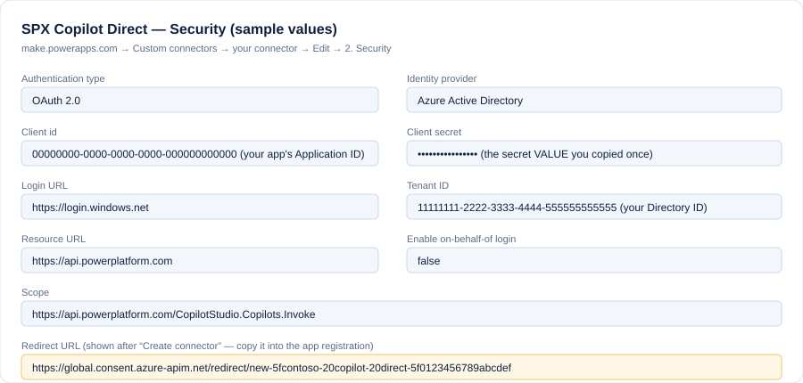 |

---

## 🧭 How it works

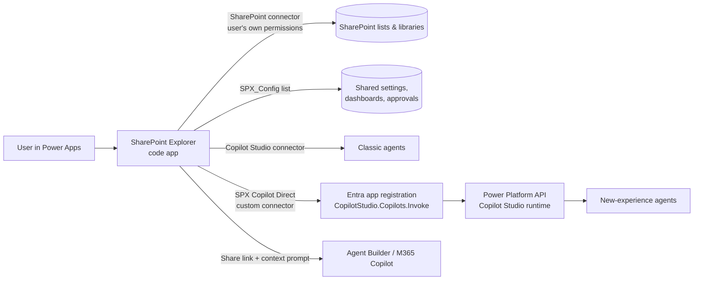

* Everything runs **as the signed-in user** — SharePoint permissions, connections and Copilot access are the user's own.
* Only the data you choose is sent to an agent (selected items' titles and key columns, optional).

---

## 🧰 Requirements

| Need | Why | Link |
|---|---|---|
| Windows + PowerShell | runs `Deploy.cmd` | – |
| **Power Apps Premium** licence (users) | code apps + premium connectors | https://learn.microsoft.com/power-apps/developer/code-apps/overview |
| SharePoint connection | data | https://make.powerapps.com → *Connections* |
| **Node.js** + **Power Platform CLI (`pac`)** | build & publish (installed by `Deploy.cmd` if missing) | https://nodejs.org · https://learn.microsoft.com/power-platform/developer/cli/introduction |
| *New-experience agents only:* **Azure CLI** | creates the Entra app + connector | https://aka.ms/installazurecliwindows |
| *New-experience agents only:* an admin who can **create app registrations and grant admin consent** | one-time setup | https://entra.microsoft.com |
| A **published** Copilot Studio agent, *Authentication = Authenticate with Microsoft* | the agent to talk to | https://copilotstudio.microsoft.com |

---

## 🚀 Quick start (15 minutes)

1. Unzip the package, double-click **`Deploy.cmd`**.
2. Enter your **environment ID** (the GUID in `make.powerapps.com/environments/<GUID>/…`).
3. Answer the AI question: **1** classic agents · **2** new-experience agents · **3** both · *Enter* skip.
4. If asked, create the **SharePoint connection** once (sign-in cannot be scripted). The script opens the page and waits.
5. Open the published app → **Connect** → site → list/library → **Connect**.
6. Share the app with your users in https://make.powerapps.com.

> Try it without deploying: double-click `Run-Demo.cmd` (sample data, no tenant needed).

Re-run `Deploy.cmd` any time to publish a new version; it updates the same app.

---

## 🤖 AI assistant — pick your agent type

| Agent | Works in-app chat? | What you need |
|---|---|---|
| **Classic** Copilot Studio agent (Topics in the left menu) | ✅ yes | Nothing extra — Microsoft's *Copilot Studio* connector (`Deploy.cmd` option **1**) |
| **New experience** agent (Skills / Connected agents, no Topics; picker shows *· new experience*) | ✅ yes | **Custom connector "SPX Copilot Direct" + your own Entra app registration** (option **2**, see below) |
| Agent Builder / Microsoft 365 Copilot / Copilot Lite | 🔗 link | No API exists. Paste the agent's *Share* link; the app opens it and copies a **prompt with context**. |

> **Why an app registration for new-experience agents?** Copilot Studio's direct endpoint needs a token with the delegated permission `CopilotStudio.Copilots.Invoke`. Microsoft's own *HTTP with Microsoft Entra ID* connectors sign in through Microsoft-owned apps, and Entra does not allow those to be consented for this API — they always end in **403 `InsufficientDelegatedPermissions`**. A custom connector that signs in through **your own app registration** is the supported route.

---

## 🟢 Classic Copilot Studio agents (no extra setup)

1. In Copilot Studio create a **classic** agent, **publish** it, set **Authentication → Authenticate with Microsoft**, share it with your users.
2. Run `Deploy.cmd`, choose **1** (or `Deploy.cmd -AddCopilotStudio`). The script attaches the **Microsoft Copilot Studio** connector (`shared_microsoftcopilotstudio`) — create that connection when asked.
3. In the app: **Assistant → Setup → Add Copilot Studio agent** → pick the agent from the drop-down → **Test connection** → **Save assistant**.

Connector reference: https://learn.microsoft.com/connectors/microsoftcopilotstudio/

---

## 🔵 New-experience agents: custom connector + app registration

### Option A — automatic (recommended)

```powershell
# as an admin who may create app registrations (Azure CLI + PowerShell 7)
./scripts/Setup-CopilotStudioConnector.ps1 -EnvironmentId <your-environment-GUID>
```
…or simply run `Deploy.cmd`, choose **2**, and answer **Y** to *“Create it now?”*. The script:
1. signs you in to Azure and makes sure the **Power Platform API** exists in your tenant;
2. creates the Entra app **SharePointExplorer-CopilotStudio** (single tenant) with the delegated permission **`CopilotStudio.Copilots.Invoke`**, grants **admin consent**, creates a client secret;
3. writes the connector files for your environment and creates the custom connector **SPX Copilot Direct** (`pac connector create`);
4. reads the connector's **own redirect URI** and registers it on the app (or asks you to paste it);
5. prints the next steps.

Then:
6. **Power Apps → Connections → New connection → SPX Copilot Direct** → sign in once (each user does this the first time).
7. Run `Deploy.cmd` again → **2** → it attaches the connector to the app and republishes.
8. In the app: **Assistant → Setup → Add Copilot Studio agent** → pick the agent → **Test connection** (four green ticks) → **Save assistant**.

### Option B — by hand in the portals

<details>
<summary><b>1 · Entra app registration</b></summary>

1. https://entra.microsoft.com → **Identity → Applications → App registrations → New registration**
   * Name `SharePointExplorer-CopilotStudio` · *Accounts in this organizational directory only*.
2. **API permissions → Add a permission → APIs my organization uses →** search **Power Platform API** (App ID `8578e004-a5c6-46e7-913e-12f58912df43`; if it is missing run `az ad sp create --id 8578e004-a5c6-46e7-913e-12f58912df43`) **→ Delegated permissions → CopilotStudio → `CopilotStudio.Copilots.Invoke`** (id `204440d3-c1d0-4826-b570-99eb6f5e2aeb`) **→ Add**, then **Grant admin consent**.
3. **Certificates & secrets → New client secret** → copy the **value** now.
4. Note the **Application (client) ID** and **Directory (tenant) ID**.
5. **Authentication → Add a platform → Web** and add the redirect URIs *(step 3 of the connector gives you the second one)*:
   * `https://global.consent.azure-apim.net/redirect`
   * `https://global.consent.azure-apim.net/redirect/<connector-name>` — e.g. `…/redirect/new-5fspx-20copilot-20direct-5f<hash>`. Copy it from the connector's *Security* tab (**Redirect URL**) or from the sign-in error `AADSTS50011`. Case-sensitive, no trailing slash.
</details>

<details>
<summary><b>2 · Custom connector</b></summary>

1. https://make.powerapps.com → your environment → **More → Custom connectors → New custom connector → Import an OpenAPI file** → choose `copilot-connector/apiDefinition.swagger.json` (the `host` in this shared file is a placeholder — generate the real one for your environment with `./scripts/Setup-CopilotStudioConnector.ps1 -EnvironmentId <GUID> -SwaggerOnly`, which writes `copilot-connector-output/apiDefinition.swagger.json`, or replace `YOUR-ENVIRONMENT-HOST` by hand).
2. Connector name: **SPX Copilot Direct** (the deploy script looks for this name).
3. **Security** tab → **OAuth 2.0**:
   | Setting | Value |
   |---|---|
   | Identity provider | **Azure Active Directory** |
   | Client id / secret | from your app registration |
   | Login URL | `https://login.windows.net` |
   | Tenant ID | your tenant GUID |
   | Resource URL | `https://api.powerplatform.com` |
   | Scope | `https://api.powerplatform.com/CopilotStudio.Copilots.Invoke` |
   | Enable on-behalf-of login | off |
4. **Create connector**, copy the shown **Redirect URL** into the app registration (step 1.5), then create the connection and run `Deploy.cmd` (option 2).
</details>

### Updating an existing connector definition
Power Apps → **Custom connectors → SPX Copilot Direct → Edit → Swagger editor** → replace everything with `copilot-connector/apiDefinition.swagger.json` → **Update connector** → run `Deploy.cmd` (option 2) so the app picks up the operations. Same connection, same app registration.

---

## 📜 The Swagger (OpenAPI) file

`copilot-connector/apiDefinition.swagger.json` is the verified definition (it worked on a real tenant; the environment-specific `host` is replaced by a placeholder — use `-SwaggerOnly` to get yours). It declares:

* **`Discover`** — `GET /copilotstudio/agents/{agent}/conversation-endpoints` → returns the agent's real conversation URLs.
* **`Path4` … `Path12`** — `POST /{s1}/…/{sN}` + optional `api-version` + JSON body. Copilot Studio's routes are long (e.g. `/copilotstudio/agenticruntime/3p/dataverse-backed/authenticated/bots/<schema>/conversations`); a single path parameter would encode the slashes (`%2F` → **404 RouteNotFound**), so there is one operation per segment count and every segment is its own parameter. The app picks the right operation automatically.
* `host` = `<env GUID without dashes, last 2 chars after a dot>.environment.api.powerplatform.com` (e.g. `YOUR-ENVIRONMENT-HOST.environment.api.powerplatform.com`).

---

## 💻 Developer guide — from scratch, step by step

Goal: take a **brand-new Power Apps code app** and let it chat with a **new-experience Copilot Studio agent** (built on the *GitHub Copilot harness* — left menu shows *Skills / Connected agents*, no *Topics*). Everything below uses **sample values** — replace the ones in `<angle brackets>` or `ALL_CAPS`.

> **Words to know** — *Code app*: a web app (React/Vite) that runs inside Power Apps and uses connectors with each user's own sign-in. *Connector*: a ready-made door to a service. *Custom connector*: a door you describe yourself with a Swagger (OpenAPI) file. *App registration*: the identity your tenant gives an app so it may request permissions. *Environment ID*: the GUID of your Power Platform environment.

### Step 0 — Prerequisites
| Install | Check |
|---|---|
| [Node.js LTS](https://nodejs.org) | `node -v` |
| [Azure CLI](https://aka.ms/installazurecliwindows) | `az version` |
| [Power Platform CLI](https://learn.microsoft.com/power-platform/developer/cli/introduction) (`dotnet tool install --global Microsoft.PowerApp.CLI.Tool`) | `pac` |
| PowerShell 7 | `pwsh -v` |

You also need: a **Power Apps Premium** licence, an account allowed to **create app registrations and grant admin consent**, and a **published** Copilot Studio agent with **Authentication = Authenticate with Microsoft**.

### Step 1 — Set the sample variables
```powershell
$ENV_ID    = "00000000-0000-0000-0000-000000000000"   # Power Platform environment ID (make.powerapps.com/environments/<ID>/…)
$APP_NAME  = "MyApp-CopilotStudio"                    # name of the Entra app registration
$CONNECTOR = "My Copilot Direct"                      # display name of the custom connector
$PP_API    = "8578e004-a5c6-46e7-913e-12f58912df43"   # Power Platform API (same for every tenant)
$SCOPE_ID  = "204440d3-c1d0-4826-b570-99eb6f5e2aeb"   # CopilotStudio.Copilots.Invoke (same for every tenant)

# connector host = environment ID without dashes; the LAST 2 characters come after a dot
$h = ($ENV_ID -replace '-','').ToLower()
$HOST_NAME = "$($h.Substring(0,$h.Length-2)).$($h.Substring($h.Length-2)).environment.api.powerplatform.com"
```

### Step 2 — Create the Entra app registration (authentication)
```powershell
az login --allow-no-subscriptions
$TENANT_ID = az account show --query tenantId -o tsv

az ad sp create --id $PP_API 2>$null            # make sure the Power Platform API exists in your tenant (ignore "already exists")

$APP_ID = az ad app create --display-name $APP_NAME --sign-in-audience AzureADMyOrg `
            --web-redirect-uris "https://global.consent.azure-apim.net/redirect" --query appId -o tsv
az ad sp create --id $APP_ID | Out-Null

az ad app permission add --id $APP_ID --api $PP_API --api-permissions "$SCOPE_ID=Scope"   # delegated CopilotStudio.Copilots.Invoke
az ad app permission admin-consent --id $APP_ID                                          # needs an admin

$SECRET = az ad app credential reset --id $APP_ID --append --display-name connector --years 1 --query password -o tsv
```
Keep `$APP_ID`, `$TENANT_ID` and `$SECRET` private (the secret is shown **once**). Portal route: see *Option B* above.

### Step 3 — Write the two connector files
**`apiDefinition.swagger.json`** — the full, verified file is [`copilot-connector/apiDefinition.swagger.json`](copilot-connector/apiDefinition.swagger.json). Replace `YOUR-ENVIRONMENT-HOST` with `$HOST_NAME` (or generate it: `./scripts/Setup-CopilotStudioConnector.ps1 -EnvironmentId $ENV_ID -SwaggerOnly`). The important parts:
```jsonc
{
  "swagger": "2.0",
  "info": { "title": "My Copilot Direct", "version": "1.0" },
  "host": "YOUR-ENVIRONMENT-HOST.environment.api.powerplatform.com",
  "basePath": "/", "schemes": ["https"],
  "consumes": ["application/json"], "produces": ["application/json"],
  "paths": {
    // 1) ask Copilot Studio where the agent's conversation endpoints are
    "/copilotstudio/agents/{agent}/conversation-endpoints": {
      "get": { "operationId": "Discover", "parameters": [ { "name": "agent", "in": "path", "required": true, "type": "string" } ],
               "responses": { "200": { "description": "OK" }, "default": { "description": "Error" } } }
    },
    // 2) generic POST with N path segments — one operation per N (Path4 … Path12) so slashes are NOT encoded
    "/{s1}/{s2}/{s3}/{s4}/{s5}/{s6}/{s7}/{s8}": {
      "post": { "operationId": "Path8",
        "parameters": [ { "name": "s1", "in": "path", "required": true, "type": "string" }, /* … s2 … s8 … */
                       { "name": "api-version", "in": "query", "required": false, "type": "string" },
                       { "name": "body", "in": "body", "required": true, "schema": { "type": "object" } } ],
        "responses": { "200": { "description": "OK" }, "default": { "description": "Error" } } }
    }
    /* … Path4, Path5, Path6, Path7, Path9 … Path12 … */
  }
}
```
**`apiProperties.json`** — tells Power Platform how to sign users in (no secret is stored in git; paste yours locally):
```json
{
  "properties": {
    "connectionParameters": {
      "token": {
        "type": "oauthSetting",
        "oAuthSettings": {
          "identityProvider": "aad",
          "clientId": "<APP_ID>",
          "clientSecret": "<SECRET>",
          "scopes": [ "https://api.powerplatform.com/CopilotStudio.Copilots.Invoke" ],
          "redirectMode": "GlobalPerConnector",
          "redirectUrl": "https://global.consent.azure-apim.net/redirect",
          "properties": { "IsFirstParty": "False", "AzureActiveDirectoryResourceId": "https://api.powerplatform.com" },
          "customParameters": {
            "loginUri":   { "value": "https://login.microsoftonline.com" },
            "tenantId":   { "value": "<TENANT_ID>" },
            "resourceUri":{ "value": "https://api.powerplatform.com" },
            "enableOnbehalfOfLogin": { "value": "false" }
          }
        }
      }
    },
    "iconBrandColor": "#2E7D32", "capabilities": [], "publisher": "My Company", "stackOwner": "My Company"
  }
}
```

### Step 4 — Create the custom connector
```powershell
pac auth create --environment $ENV_ID
pac connector create --api-definition-file .\apiDefinition.swagger.json --api-properties-file .\apiProperties.json --environment $ENV_ID
```
No `pac connector` in your version? Use the portal: **Power Apps → Custom connectors → New → Import an OpenAPI file**, then set **Security** as in the picture below.

<div align="center"></div>

### Step 5 — Register the connector's redirect URI (the step everyone misses)
Every OAuth custom connector has its **own** redirect URI. Open the connector → **Security** → copy **Redirect URL** (it ends with your connector's unique name, e.g. `…/redirect/new-5fcontoso-20copilot-20direct-5f0123456789abcdef`), then add it to the app registration. `az … update --web-redirect-uris` **replaces** the list, so always pass both:
```powershell
az ad app update --id $APP_ID --web-redirect-uris `
  "https://global.consent.azure-apim.net/redirect" `
  "https://global.consent.azure-apim.net/redirect/<your-connector-unique-name>"
az ad app show --id $APP_ID --query web.redirectUris        # verify both are listed
```

<div align="center"></div>

### Step 6 — Create the connection (each user, once)
https://make.powerapps.com → **Connections → New connection → My Copilot Direct** → sign in. Then note:
```powershell
pac connection list      # copy the Connection ID and the connector's API name (shared_…)
```

### Step 7 — Create a new code app
```bash
npm create vite@latest my-agent-app -- --template react-ts
cd my-agent-app && npm install && npm install @microsoft/power-apps
pac code init --displayName "My Agent App"
pac code add-data-source -a <API_NAME_FROM_STEP_6> -c <CONNECTION_ID>
```
`add-data-source` writes `.power/schemas/appschemas/dataSourcesInfo.ts`. Open it and confirm the connector lists **`Discover`** and **`Path4` … `Path12`** (if not, the connector definition is old — update it in the Swagger editor and run the command again).

### Step 8 — Add the chat helper and a screen
Copy [`copilot-connector/example/copilotDirect.ts`](copilot-connector/example/copilotDirect.ts) to `src/copilotDirect.ts`, then:
```tsx
// src/App.tsx
import { useState } from 'react'
import { askAgent } from './copilotDirect'

const AGENT = 'cr123_myagent'   // Copilot Studio → agent → Settings → Advanced → Metadata → Schema name (case-sensitive)

export default function App() {
  const [q, setQ] = useState(''), [a, setA] = useState(''), [conv, setConv] = useState<string>()
  const [busy, setBusy] = useState(false)
  const send = async () => {
    setBusy(true)
    try { const r = await askAgent(AGENT, q, conv); setA(r.text); setConv(r.conversationId) }
    catch (e) { setA('⚠ ' + (e as Error).message) }
    finally { setBusy(false) }
  }
  return (
    <main style={{ maxWidth: 640, margin: '40px auto', fontFamily: 'Segoe UI, sans-serif' }}>
      <h1>Ask my agent</h1>
      <textarea value={q} onChange={(e) => setQ(e.target.value)} rows={3} style={{ width: '100%' }} />
      <button onClick={send} disabled={busy || !q.trim()}>{busy ? 'Thinking…' : 'Send'}</button>
      <pre style={{ whiteSpace: 'pre-wrap' }}>{a}</pre>
    </main>
  )
}
```

### Step 9 — Build, publish, test
```bash
npm run build
pac code push
```
Open the app from https://make.powerapps.com → **Apps**, approve the connection prompt once, ask a question. 🎉

### Step 10 — Make it production-ready
* Keep the **conversation id** (done above) so the agent remembers earlier turns; add a **New chat** button that clears it.
* Add a **timeout** (a turn can take 30 s+) and show the thrown messages — they are written for users.
* Treat replies like `Sorry, something unexpected happened … LatestPublishedVersionNotFound` as errors (the agent is not published). See `askD2E` in `src/services/sp.ts`.
* Never put the client secret, tenant ID or connection IDs in source control; rotate the secret every year.

### How the calls flow
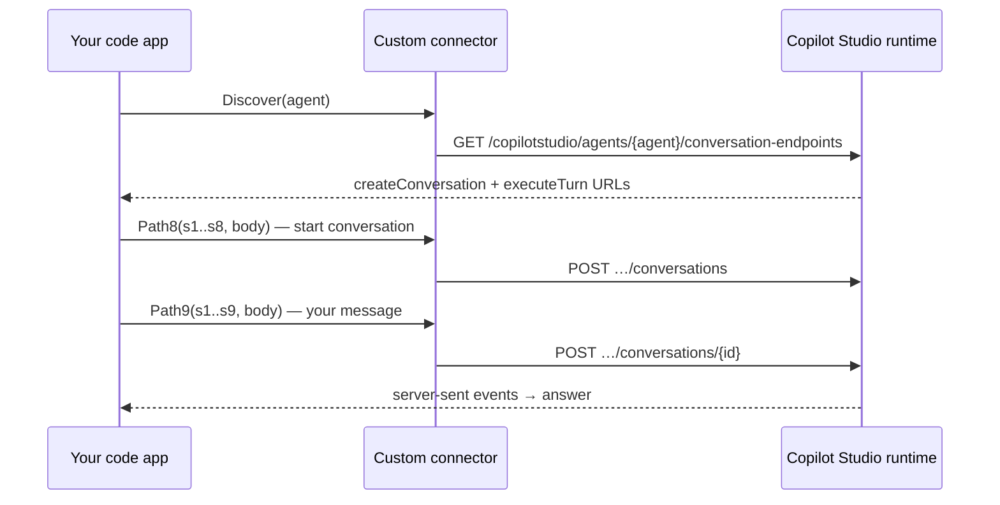
Each call carries **the signed-in user's token**, issued for **your app registration** with the delegated permission `CopilotStudio.Copilots.Invoke`.

---

## 🔑 Authentication & URL reference

| What | Value (sample) | Where it is used |
|---|---|---|
| **Token audience / Resource URL** | `https://api.powerplatform.com` | connector *Security → Resource URL* |
| **Scope** | `https://api.powerplatform.com/CopilotStudio.Copilots.Invoke` | connector *Security → Scope* · Entra *API permissions* (delegated) |
| **Power Platform API app ID** | `8578e004-a5c6-46e7-913e-12f58912df43` | `az ad app permission add --api …` |
| **Permission (scope) ID** | `204440d3-c1d0-4826-b570-99eb6f5e2aeb` | `--api-permissions "<id>=Scope"` |
| **Login URL** | `https://login.windows.net` (portal) · `https://login.microsoftonline.com` (`apiProperties.json`) | connector *Security* |
| **Tenant ID** | `11111111-2222-3333-4444-555555555555` | connector *Security → Tenant ID* |
| **Client ID / secret** | your app's Application ID / secret value | connector *Security* |
| **Redirect URI #1 (generic)** | `https://global.consent.azure-apim.net/redirect` | Entra → *Authentication → Web* |
| **Redirect URI #2 (per connector)** | `https://global.consent.azure-apim.net/redirect/<connector-unique-name>` | Entra → *Authentication → Web* (**required**) |
| **Connector host** | `<30 hex chars>.<last 2 chars>.environment.api.powerplatform.com` | Swagger `host` |
| **Discovery route** | `GET /copilotstudio/agents/{schema}/conversation-endpoints` | `Discover` operation |
| **Agent schema name** | `cr123_myagent` | Copilot Studio → *Settings → Advanced → Metadata* |
| **Environment ID** | `00000000-0000-0000-0000-000000000000` | `pac` commands · Metadata page |

**Rules of thumb:** the platform type of the redirect URIs must be **Web**; they are **case-sensitive** with no trailing slash; the app in an `AADSTS50011` error message must be **the same app** your connector uses; Microsoft's own *HTTP with Microsoft Entra ID* connectors **cannot** be used (they always return 403 for this API).

---

## 🔗 All the links you need

| What | URL |
|---|---|
| Power Apps maker portal | https://make.powerapps.com |
| Connections (create *SharePoint*, *Copilot Studio*, *SPX Copilot Direct*) | `https://make.powerapps.com/environments/<ENV-ID>/connections` |
| Custom connectors | `https://make.powerapps.com/environments/<ENV-ID>/customconnectors` |
| Apps (find the published app) | `https://make.powerapps.com/environments/<ENV-ID>/apps` |
| Copilot Studio | `https://copilotstudio.microsoft.com/environments/<ENV-ID>/home` |
| Agent metadata (schema name, environment ID) | Copilot Studio → agent → **Settings → Advanced → Metadata** |
| **Entra app registrations** | https://entra.microsoft.com → *Applications → App registrations* (or https://portal.azure.com/#view/Microsoft_AAD_RegisteredApps/ApplicationsListBlade) |
| Redirect URI (generic) | `https://global.consent.azure-apim.net/redirect` |
| Redirect URI (per connector) | `https://global.consent.azure-apim.net/redirect/<connector-name>` |
| Power Platform API permission | App ID `8578e004-a5c6-46e7-913e-12f58912df43` · scope `CopilotStudio.Copilots.Invoke` (`204440d3-c1d0-4826-b570-99eb6f5e2aeb`) |
| Token audience | `https://api.powerplatform.com` |
| Azure CLI download | https://aka.ms/installazurecliwindows |
| Power Platform CLI docs | https://learn.microsoft.com/power-platform/developer/cli/introduction |
| Code apps docs | https://learn.microsoft.com/power-apps/developer/code-apps/overview |
| Custom connector OAuth (Entra) docs | https://learn.microsoft.com/connectors/custom-connectors/azure-active-directory-authentication |

---

## 🔐 Security & privacy checklist

* **Nothing tenant-specific is shipped.** The package contains placeholders only (`xxxxxxxx-xxxx-…`, `YOUR-ENVIRONMENT-HOST`, `<app-client-id>`, `cr123_…`). Your environment ID, tenant ID, client ID, connector name and agent schema stay on your machine and in Power Platform.
* **Secrets:** the client secret exists only in the generated `copilot-connector-output/apiProperties.json` and inside the custom connector. That folder is git-ignored — never commit or e-mail it. Rotate the secret before it expires (2 years) or if it leaks (`az ad app credential reset --id <app-client-id> --append`).
* **Before you share screenshots or logs**, blank out: site URLs, environment/tenant/app IDs, user names and e-mail addresses, agent names/schema names, and the `redirect_uri` inside sign-in errors.
* **Least privilege:** the Entra app only holds the delegated `CopilotStudio.Copilots.Invoke` permission; everything runs as the signed-in user, so SharePoint and Copilot permissions are the user's own.
* `power.config.json`, `.power/` and `.deploy-state` are git-ignored because they link a folder to your tenant's app.

---

## ❓ FAQ & troubleshooting

<details><summary><b>403 <code>InsufficientDelegatedPermissions … CopilotStudio.Copilots.Invoke</code></b></summary>
You are using a Microsoft HTTP connector. Use the custom connector <b>SPX Copilot Direct</b> with your own app registration (above). Run <code>Deploy.cmd</code> → 2.
</details>

<details><summary><b>Sign-in error <code>AADSTS50011</code> — redirect URI does not match</b></summary>
Add the exact URI from the error text to the app named in the error (search App registrations by the GUID after <i>“for the application”</i>) under <b>Authentication → Web</b>, save, wait a few minutes, retry in an InPrivate window. Several connectors with the same name each have their own URI — delete extras in Custom connectors.
</details>

<details><summary><b>404 <code>RouteNotFound</code> or “no operation for an N-part route”</b></summary>
The connector has an old definition. Paste <code>copilot-connector/apiDefinition.swagger.json</code> in the connector's Swagger editor, <b>Update connector</b>, then run <code>Deploy.cmd</code> (2) again (extract to a new folder if it still says the old definition).
</details>

<details><summary><b>“Copilot Direct connector is not attached to this app”</b></summary>
Create the <b>SPX Copilot Direct</b> connection (Connections → New connection) and run <code>Deploy.cmd</code> → 2.
</details>

<details><summary><b>Agent is “not published yet” / answers “Sorry, something unexpected happened … LatestPublishedVersionNotFound”</b></summary>
Publish it in Copilot Studio and set <b>Authentication → Authenticate with Microsoft</b>. For new-experience agents Microsoft is still rolling the runtime out by region — a “not supported yet” message can appear until yours has it.
</details>

<details><summary><b>The agent drop-down is empty</b></summary>
It reads the Dataverse <code>bot</code> table; your role needs read access to it (<code>prvReadbot</code>). You can always type the schema name instead.
</details>

<details><summary><b>Can I use the custom connector on its own — in a Power Automate flow, a canvas app or another app?</b></summary>

**Yes inside Power Platform; outside it you need your own sign-in.** A custom connector is a normal Power Platform artifact, not something tied to this app.

| Where | Works? | Notes |
|---|---|---|
| **Power Automate** (cloud flows) | ✅ | Add the connector in a flow and pick the *Discover* / *PathN* actions. The flow runs as the person who created the connection, so use a dedicated, licensed service account for scheduled flows. |
| **Canvas apps / model-driven apps** | ✅ | Add it as a data source; each user signs in to their own connection. |
| **Other code apps** | ✅ | Follow the developer guide, step 7 onwards (`pac code add-data-source`). One connector serves every app in the environment. |
| **Copilot Studio (as a tool / action)** | ⚠️ not tested | Custom connectors can normally be added as tools; you would expose a friendlier operation than the generic `PathN` ones. |
| **VS Code, scripts, other web apps** | ➖ not via the connector | The connector is not an API you can call from outside Power Platform. Reuse the **same Entra app registration** with your own OAuth flow (MSAL) and call the Copilot Studio endpoints directly — add that app type's redirect URI to the registration. Not covered by this repo. |

**Practical tips for flows**
* The `PathN` actions are deliberately generic (they take the route segments Copilot Studio returns). For a flow, add one or two **friendly operations** to the swagger — for example `CreateConversation` and `SendMessage` with fixed paths from your `Discover` result — and hide the generic ones.
* Replies arrive as **server-sent events text**; parse the `data:` lines (see `copilotDirect.ts`) or use a *Parse JSON* step on the part you need.
* Agent turns can take a while — set a generous action timeout and handle failures with a retry.
* Remember the **published agent** and **Authenticate with Microsoft** requirements, and that each connection holds one user's permissions.
</details>

<details><summary><b>Do I have to use an app registration?</b></summary>
Only for in-app chat with <i>new-experience</i> agents. Classic agents need none. Without it, use <b>Add this agent as a link instead</b> (opens the agent; optional “Chat here” embeds the Copilot Studio web chat if your tenant allows it).
</details>

<details><summary><b>“Not enough memory to open this page” / Aw, Snap</b></summary>
That is the browser out of memory (many Power Apps tabs). Close other tabs or use a separate window. The app caps rows at 40,000, drops caches under memory pressure and recovers without a reload; Diagnostics shows its error log.
</details>

<details><summary><b>Security notes</b></summary>
The client secret lives only in the connector. <code>copilot-connector/apiProperties.json</code> (generated by the script) contains it — keep it private. Agents run as each user; rotate the secret before it expires (2 years by default).
</details>

---

## 📚 Full feature reference

## Approvals (lists and libraries, multi-layer)

Admins (data admins / app owners) open **Approvals → Design workflow** and build the process for that list or library:
- Any number of **approval layers (steps)**, reorderable; each has a name, its own **approvers** (people or SharePoint groups, searched from the directory), a rule (**any one** approver or **everyone** must approve) and optional **due days**.
- Options: comment required to reject, whether submitters may approve their own request, and who may submit (editors / everyone / admins). The workflow can be turned off at any time; running requests keep a snapshot of their steps.
- Users select files/items and press **Submit for approval** (or use the row menu → *Approval…*). Each approver sees **Approvals → Waiting for me** and can **Approve**, **Reject** or **Request changes** with a comment; the request moves to the next layer automatically. Rejected / changes-requested items can be **resubmitted**.
- Every file/item shows an **approval tag** in the grid (Pending 1/2, Approved, Rejected…), and the details panel has an **Approval** tab with the step tracker, who is being waited on, due dates and the complete **history** (who, what, when, comment). Admins also get *Everything* with status filters.
- **Notify approvers / submitter** opens a prefilled Outlook-on-the-web message.
- Requests and history are stored in the `SPX_Config` list, so everyone who approves needs to be able to add/edit items there (the same list that already stores personal views). Approvals do not change SharePoint's own permissions or Content Approval setting.

### Automatic approvals, conditions and more (v1.8)

In the workflow designer, **When does approval start? → Automatically**:
- Start approval **when a new file/item is created** and/or **when it is modified**, only when **ALL/ANY** of your **criteria** match (e.g. *Department is Legal*, *Amount ≥ 5000*). For modifications you can choose **watched columns** (re-approve only when those change) and whether an edit while still waiting **restarts** the approval. A **Pause** switch stops automatic submissions without touching anything else.
- Items created/changed before you save are never submitted, so enabling it does not flood old data. Files still being saved/checked in (changed in the last 90 s) wait for the next check; one check submits at most 25 items.
- The check runs while **anyone has the app open** (after each save and about every 45 s) and works for changes made in SharePoint too. It cannot run when nobody has the app open — for guaranteed always-on triggering pair it with a Power Automate flow.
- **Conditional layers:** any step can be limited with conditions (e.g. a CFO layer only when *Amount ≥ 10000*); if no layer applies the item is recorded as automatically approved.
- **Escalation:** a step with *Due in N days* can add escalation approvers when it becomes overdue.
- **Delegate…** hands your part of a step to someone else; **bulk Approve / Reject** from *Waiting for me*; **Export history (CSV)** audit trail; an **Approvals** dashboard widget (pending / overdue / approved / average days). Two people acting on the same request at once are detected and the second is asked to refresh.

## Email files and folders (libraries)

Select files/folders (or row menu → **Email…**) and press **Email**. They go in as links (optionally "people in my organization can view" sharing links). Then:
- **Open in Outlook (web)** – a prefilled compose window.
- **Default mail app** – `mailto:`; **Copy message** – rich text on the clipboard (always works); **Download .eml** – a draft file, with files from your computer attached (classic Outlook opens it as an editable draft; downloads can be blocked inside Power Apps).
SharePoint's old built-in mail API was retired by Microsoft in 2025, so the app no longer sends mail itself — nothing is sent until you press Send in your mail client.

## Customizable live dashboard (admins)

Until an admin designs one, everyone sees the auto-built dashboard. Data admins and app owners get a **Customize dashboard** button:

- **Widgets:** Number (count / sum / average / smallest / largest of any column), Goal gauge, Bar chart, Donut chart, Timeline (day / week / month / year), Top-N list, and Note.
- Each widget can have its own title, width, grouping column and an optional **"only count items where…"** filter; click a KPI or chart slice to jump to the matching items.
- Add, edit, remove and reorder widgets, set the auto-refresh (30 s / 1 min / 5 min) and press **Save for everyone**. The layout is stored per list in the `SPX_Config` list, so everybody sees the admin's dashboard, always computed from live data and each person's own SharePoint permissions.
- **Reset to auto** returns everyone to the auto-built dashboard. Regular users never see the editor.
- On huge lists the widgets use the latest 3,000 items (exact total shown for unfiltered counts); **Scan everything** streams every item without freezing the app.

## Inline editing and colour rules
* **Edit right in the grid (Excel-style)**: double-click a cell, or move with the arrow keys and press **Enter / F2**. **Enter** saves and moves down, **Tab / Shift+Tab** saves and moves sideways, **Esc** cancels, **Ctrl+Z** undoes the last edit (20 steps). Text, numbers, currency, dates, Yes/No and choice columns edit inline; notes, people, multi-choice and links open the full form. Contributors/admins only; every edit is checked against SharePoint permissions and rolled back with a message if refused. The title column still opens details on click; **Shift+Enter** always opens details.
* **Colour rules (conditional formatting)**: *Format* → add rules like *Status is Blocked → red ⚑* or *Due date before today → orange*. Row or cell scope, bold/strike-through, ordered priority, relative dates (`today`, `today-7`, `today+30`), a legend with counts (click to filter). Saved **just for you** or, for data admins/owners, **for everyone** on the list. Applied in table, board and calendar; colour is always paired with a marker for accessibility.
* Both features were picked by the Fable 5.1 advisor from community demand (editable grids and conditional formatting are among the most requested things for SharePoint list apps).

## Troubleshooting
* Header shows a green **● Live** and the footer says `Build v1.3.0 · live SharePoint data` when you are on live data. An orange **SAMPLE DATA** bar means you are on made-up data (e.g. `Run-Demo.cmd` or an old copy of the app).
* Click **● Live** (or “Connection diagnostics” in Ctrl+K) to see what is working: data sources in the build, Power Apps context, the SharePoint connection, a REST test on a site.
* A column SharePoint refuses to return (some system columns) is skipped automatically instead of breaking the list.

## How to run
**A. Try it on your PC (no deployment, sample data):** unzip, double-click **`Run-Demo.cmd`** (installs Node.js if needed, then opens http://127.0.0.1:3000/?demo=1). Or in a terminal: `npm install` then `npm run dev`.

**B. Deploy to Power Platform:** unzip, double-click **`Deploy.cmd`**, enter your environment ID (the GUID in `make.powerapps.com/environments/<GUID>/…`). It installs Node/`pac` if missing, signs you in, wires the SharePoint connector, makes you the app owner, builds and publishes. Then open the app → **Connect** → pick the site and list/library → **Connect**, and share the app with your users.

## Forms for lists with many columns
* **Tabbed form on one screen**: lists with more than 8 editable columns open the New/Edit form as tabs (Essentials, Status & details 1/2, People & dates, Notes & links, Attachments). Tabs show how many **required** fields are still empty, jump to the first error on save, and work with arrow keys; **Back/Next** buttons move through them. Switch to **One page** any time.
* **Draft autosave** for new items (resume or discard after a crash or closed tab), **Duplicate** an existing item, quick date buttons, `Ctrl+Enter` to save.
* **Calendar view** over any date column: click a day to add an item on that date, drag an item to another day to reschedule it, "+n more" pop-ups.
* **Import from CSV**: map columns, validation per row (choices, numbers, dates, Yes/No, people), progress, and a downloadable file of skipped rows. Template download included.
* Ideas came from what the Power Apps community keeps asking for around SharePoint list apps (tabbed forms, calendar views, CSV import); the code-apps community itself publishes few public feature threads, so this is a judgment call.

## Deploy (zero touch)

```powershell
./scripts/Deploy-SharePointExplorer.ps1                       # prompts for environment + config site
./scripts/Deploy-SharePointExplorer.ps1 -EnvironmentId <guid> -ConfigSiteUrl https://contoso.sharepoint.com/sites/Apps
# or just double-click Deploy.cmd
```
It installs Node / `pac` if missing, signs you in, picks the environment, registers the SharePoint connector, **bakes the app
owner into the bundle** (you, or `-OwnerUpn a@x.com,b@x.com`), builds and runs `pac code push`.
The one thing that cannot be scripted is the one-time OAuth sign-in that creates the SharePoint *connection*; if it is missing
the script opens the right page and waits.

Then: open the app → **Connect** tab → site → list/library → **Connect**. Every user now opens the same data.
Share the app with users in make.powerapps.com (code apps need a Power Apps premium licence).

## Who can connect what
* Only **owners** (listed in `src/appconfig.json`, written by the deploy script) see the Connect screen. Everybody else sees a read-only “Source” page.
* The choice is saved in a small list `SPX_Config` on the config site (created by the owner on first Connect) so all users get it.
* **Limits of this, stated plainly:** the gate is enforced in the app UI, and owners come from the compiled bundle. A determined
  user with edit rights on the `SPX_Config` list could still change the saved choice, so give users *Read* and owners *Edit* on that list.
  Real data security is always SharePoint permissions: each user only sees what their own connection may see.

## Roles: read-only / contributor / data admin
Roles come from the **SharePoint permissions on the connected list** (read live via `EffectiveBasePermissions` + your groups), so SharePoint
enforces them and the app only mirrors them. If SharePoint cannot answer, the app falls back to read-only.

| Role | Who | Can do |
|---|---|---|
| **Read-only** | any Microsoft 365 user with *Read* | search, filter, dashboards, views, export |
| **Contributor** | members of a SharePoint group with *Contribute/Edit* | + add items, edit items |
| **Data admin** | *Full Control / Manage Lists* (or named admin groups) | + delete (to the recycle bin), bulk delete, shared views for groups |
| **App owner** | listed at deploy time | connect/disconnect lists, name optional writer/admin groups. Owners manage the *app*; data admins manage the *data*. |

Owners can additionally name **writer groups / admin groups** (Connect → Who can do what). These can only *restrict* what SharePoint allows.
A role badge in the header shows your level (hover for the reason). Libraries: metadata edit and delete only (no file upload).

## Views
Save the current search, filters, sort, columns and layout as a view: **only me**, **everyone**, **specific SharePoint groups**, or **data admins only**.
Personal views are stored per user; shared views in the `SPX_Config` list (data admins therefore need Edit on that list).
A view changes what is *shown*; it is not a security boundary: SharePoint permissions are.

## Search for millions of rows
* Up to 25k items: instant in-memory search with relevance ranking (title hits first) and highlighting.
* Larger lists: free-text uses the **SharePoint Search index** (ranked, no table scan, any size) and falls back to a filter query if nothing is indexed yet.
* Syntax everywhere: `word1 word2`, `"exact phrase"`, `-exclude`, `Status:open` (column-scoped, becomes a server filter).
* Typeahead suggestions (memory or cancellable server query) and recent searches; debounced and cancellable so typing never blocks.

## Document libraries (SharePoint-style)
* **Folder browsing** with breadcrumbs, folders first, plus an **All files** flat view; table, card and **tile gallery** layouts with colour-coded file-type icons (thumbnails for images in the live app).
* **New → Folder / Upload files / Upload folder**, drag-and-drop of files *and whole folders* (structure is recreated), progress per file, stop/retry feedback. Any file type. Uploads go through the SharePoint connector's *Create file* action, so keep files under ~100 MB (larger ones are skipped with a message).
* Row menu (⋯ or right-click): details, edit properties, **rename, move to…, copy to…**, download, copy link, manage access, delete (recycle bin). Version history tab.

## Lists: add / edit item
* Slide-in **form generated from the columns**: choice pills, multi-select chips, Yes/No switch, date quick-picks, number steppers, **people picker** (tenant directory), URL + text, notes with counter, **attachments** (add/remove), required-field progress bar, unsaved-changes guard, `Ctrl+Enter` to save, *Save & add another*.
* **Bulk edit** of selected rows, version history, attachments in the details panel, `N` shortcut for a new item.

## Security: who can access what
* **Manage access** on the list/library and on any **folder, file or list item**: see who has access, **stop/reset inheriting**, **add a person or group** with a permission level (Read, Contribute, Edit, Full Control, custom), remove access. Uses the real SharePoint permission APIs, so changes apply everywhere. Requires the *Manage permissions* right; others get a read-only “who has access” view.
* Views (saved filters/columns) can be limited to groups or admins; see *Views* above. SharePoint has no per-view permissions, so list *views* restrict what is shown, items/folders carry the real permissions.

## Search everywhere
`Ctrl+Shift+F` or **Search all**: searches every connected list/library at once, and offers one-click searches of the **Power Platform Community, Power Apps community, Microsoft Learn, Microsoft Q&A and Tech Community** (opened in a new tab; the app cannot call those sites itself).

## Board, favorites, share and record page
* **Board (Kanban)** for any list with a choice column (Status, Priority…): drag cards between columns to change the value (contributors/admins; keyboard users get a “Move to…” menu on each card). Group by any choice column.
* **Favorites**: star items (kept per user on this device) and filter to them in one click.
* **Share** (details panel, row menu): **copy an organization link** (view or edit) created through SharePoint’s sharing service, or open SharePoint’s own Share dialog for that item in a pop-up window (SharePoint does not allow its dialogs inside other pages, so it cannot be embedded; the pop-up page is undocumented and may not close itself). *Not verified against a live tenant: if it does not open, use “Open in SharePoint” and press Share there.*
* **Record page** for list items: status pills, progress ring, people and due date at a glance, and **click-to-change** status/Yes-No fields right in the details panel.
* **Links**: “Open in SharePoint” now encodes paths per segment and uses DispForm / `?web=1` for Office files / the library view for folders (the old links returned 404).
* **Personal views for everyone**: any user (including read-only) can save their own views; they are kept on the device and also in the cloud when the user may write to the settings list. Sharing a view with a group or admins still needs a data admin or owner.
* **Look and feel**: animated welcome banner, KPI sparklines and a health gauge, accent colour picker (PNC, teal, violet, rose, emerald) in Display.

## Features
| | |
|---|---|
| **Connect** | any site → lists & libraries with item counts → pick → Connect. Several sources can be published; users switch from the header. |
| **Dynamic UI** | columns, types, filters, pills, avatars, file icons, dashboard widgets and insights are generated from the list/library schema. Libraries additionally get file types, storage, largest files and a folders toggle. |
| **Auto dashboard** | KPIs, activity timeline, per-column breakdowns (click a bar → filters the grid), data health (fill rate), numeric summary, plain-language insights, “Dashboard PDF”. |
| **Search & filter** | ≤ 25k items: instant, all-column, multi-word search in memory with highlighting. Larger: server-side. Quick filters, date presets, advanced filter builder, saved views. |
| **Export** | CSV (spreadsheet-formula-safe), JSON, PDF; selected rows / loaded rows / *everything matching* streamed page by page straight to disk. |
| **Live pulse** *(extra 1)* | polls for new and changed items, toasts, highlights new rows, live feed. |
| **Smart insights + deep scan** *(extra 2)* | auto-written findings (growth vs. last week, stale items, duplicates, dominant values, sparsely filled columns) and a cancellable **deep scan** that aggregates the whole list while you keep working. |
| **More** | card/table views, resizable & hideable columns, item drawer with previous/next, command palette (Ctrl+K), “Index column” helper for owners. |
| **Accessibility** | light / dark / **high-contrast** / system themes, text-size control, keyboard-operable grid (↑↓ PgUp/PgDn Home/End, Enter, Space), ARIA grid/dialog/live regions, focus trap, skip link, reduced-motion, charts with text equivalents. axe-core reported 0 violations on the dashboard in all three themes. |

## Heavy-duty design (millions of rows, no freeze)
* **Virtualised grid** – only visible rows exist in the DOM (≈30 rows regardless of list size).
* **Keyset paging on `ID`** (never `$skip`) with `$top` ≤ 5,000, which avoids SharePoint’s 5,000-item list-view threshold; page size adapts while scrolling fast; in-memory cap of 150k rows with a clear message; a “Jump” slider seeks by ID range.
* **Server-side search/filter**, stale requests are cancelled; connector calls are throttled (4 in parallel) with exponential back-off on 429/503.
* **Streaming aggregation** for the dashboard: only counters are kept, work is chunked and yields to the UI.
* Streaming exports (File System Access API when available, chunked Blob fallback). PDF is capped at 5,000 rows by design.
* On very large lists SharePoint can only filter/sort on **indexed** columns. Owners get an **Index column** helper (Connect → Performance). Without an index SharePoint returns a threshold error, which the app explains.

## Develop
```bash
npm install
npm run dev      # starts with a built-in demo tenant (2,000,000-row list, 180k library, …); ?demo=1 forces it
npm run build
```
Outside Power Apps (or without the SharePoint connector) the app automatically uses the demo backend.

## How it talks to SharePoint
Through the code-apps SDK and the user's own SharePoint connection, using the connector's *Send an HTTP request to SharePoint*
action (plain SharePoint REST) with the site URL as the `dataset`, so one registered connector reaches any site or list. At start-up the app
adds that operation to the generated data-source description (`src/services/sp.ts`), because `pac` only describes one list for tabular connectors.

> **Status:** the SharePoint, dashboard, approval and e-mail features have been exercised against the demo backend and an in-memory emulation of SharePoint REST; the Copilot Studio integration (classic and new-experience agents through the custom connector) has been verified on a real tenant. Treat a first deployment as a pilot: connect a small list first, then a big one.


## Deploy never asks which list to connect

`pac` can only register the SharePoint connector against *some* existing list, so the deploy script finds one itself (it lists the tables on your config site and tries them, then other sites you can reach). That list is only used to register the connector — **which list or library the app shows is chosen by the admin in the app's Connect screen.** The script registers SharePoint last (pac keeps only the connector it registers last), verifies the generated schema and the built bundle, and stops with a clear error instead of publishing a broken build. After deploying, the app footer must show the new build number; if it still shows an older one you are opening an older copy of the app.

### Copilot Studio connection check (v1.9.5)

**Assistant → Setup → Add Copilot Studio agent** has **Find my agents** (lists the agents your Copilot Studio connection can see, click to fill in the exact schema name) and a step-by-step **Test connection**: connector attached → your connection sees the agent → the agent answers (with timing). Error "The request was not sent or there was no response from the server" with no HTTP status means the Power Apps player never got a reply — most often the agent's synchronous call took too long (the player gives up after about 2 minutes), or a proxy/VPN/browser extension blocked the call. Use a classic agent set to *Authenticate with Microsoft*, published, and test from another network/browser; if it keeps timing out, wrap the agent in a Power Automate flow ("Execute Agent and wait" + "Respond to Power Apps").


### Crash fix (v1.9.9)

A filter the server could not apply (multi-value people/lookup columns, relative dates from a colour-rule legend chip or a dashboard "Show items" button) made the grid page through the whole list automatically — thousands of requests and gigabytes of data — until the browser tab ran out of memory. The grid now stops after 10,000 non-matching rows and shows a "scan further" button, applies only the filters SharePoint could not apply, and resolves relative dates properly.

### Production safety nets (v1.9.10)

- **Request circuit breaker:** more than 400 SharePoint calls in in a minute pauses further calls for 30 seconds and shows a banner (a runaway loop can no longer hammer SharePoint or fill the tab with data).
- **Heap watchdog:** if the page uses more than ~700 MB of browser memory, caches are dropped, background work stops and a banner asks you to reload — instead of the tab crashing.
- **Safe mode:** if the previous session of a tab ended without a clean close (crash / out of memory), the next one starts with live pulse, automatic approvals and background scans paused, with a one-click "Turn background features on".
- Background work (live pulse, auto-approval checks, dashboard refresh) only runs while the tab is visible; server-mode lists keep at most 40,000 rows in memory.
- **Deploy.cmd** now asks which AI assistant support you want: [1] classic Copilot Studio agents, [2] new-experience agents (guides you through the one extra connection, printing the exact Base Resource URL and Resource URI), [3] both.
- Every SharePoint call times out after 60 s (reads) / 180 s (writes) and at most 48 calls may wait in the queue; the dashboard sample refreshes at most every 2 minutes; the auto-approval check runs at most every 45 s (and only after the live pulse saw a change); exports without disk streaming stop at 250,000 rows; an idle live-pulse poll no longer re-indexes or re-renders anything.

### Stability + agent drop-down (v1.9.11)

- **No more reload loops / white page:** the memory watchdog now compares with the browser's own heap limit (not a fixed number — inside the Power Apps player that figure includes the host page), recovers by itself when pressure drops, and "Continue" restarts the app view in place instead of reloading the embedded frame. An unexpected error shows a "Try again" panel (the first failure restarts the app view automatically), an empty screen is caught by a "view went blank" overlay, damaged approval records are ignored instead of crashing the page, and Power Apps not answering is no longer retried for minutes. **Diagnostics → Stability** shows memory, guard state and the last errors recorded on this device — send me that if it ever happens again.
- **Pick the agent from a drop-down:** Assistant → Setup → Add Copilot Studio agent lists the agents that exist in your environment (read from the Dataverse *bot* table, which `Deploy.cmd` adds when you choose option 2 or 3). Users need read access to the Bot table to see the list; otherwise type the schema name.

---

<div align="center">

### 💜 Created by **Kirolos — Power of Automation**

[](https://www.linkedin.com/in/kirolos-erian-39014349/)

</div>
