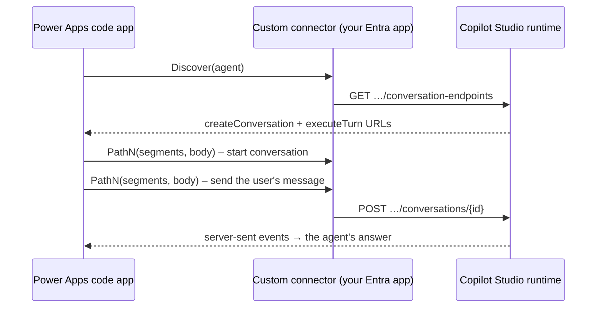

<div align="center">

# 🔌 Talking to a GitHub Copilot harness agent from a Power Apps code app

### The custom connector that bridges the gap — and the three walls I hit on the way

*By **Kirolos — Power of Automation***


</div>

---

## TL;DR

* Copilot Studio's **new experience** agents (the ones built on the **GitHub Copilot harness** — *Skills*, *Connected agents*, no *Topics*) **cannot be called through Microsoft's built-in Copilot Studio connector** from a Power Apps code app.
* Microsoft's own **HTTP with Microsoft Entra ID** connectors don't work either: they always end in **403 `InsufficientDelegatedPermissions`**.
* What *does* work: a **custom connector that signs users in through your own Entra app registration**, calling Copilot Studio's direct conversation endpoints.
* Result: a code app where users pick a harness agent from a drop-down and chat with it, in context, with their own permissions.
* Everything — scripts, swagger, helper code and a beginner-friendly guide — is open in the repo: **<https://github.com/powerofautomation2027/-PNC-SharePoint-Team-Explorer/blob/main/README.md>**

> I looked for an existing walkthrough for this and didn't find one at the time of writing, so this post documents the path that worked for me. Treat it as a field report, not official guidance — Microsoft is still rolling the harness runtime out region by region.

---

## The goal

I'd built a Power Apps **code app** that turns any SharePoint list or library into a live dashboard with approvals, e-mail and search. The natural next feature: an **AI assistant** — pick a Copilot Studio agent, ask *"what needs attention right now?"*, and have the agent see the list the user is looking at.

Classic agents were easy: the built-in **Microsoft Copilot Studio** connector exposes an *Execute Copilot* action, and that was that.

Then I created an agent in the new experience. Same environment, published, *Authenticate with Microsoft*… and the connector simply could not find it. Agents built on the **GitHub Copilot harness** run on a different runtime, and the classic connector doesn't speak to it.

## Wall #1 — "There's an HTTP connector for that"

Copilot Studio has a documented *direct-to-engine* API, so the obvious idea is to call it with a generic HTTP connector. Power Platform ships two: **HTTP with Microsoft Entra ID** (preauthorized and non-preauthorized).

Result:

```text
403 InsufficientDelegatedPermissions
Missing CopilotStudio.Copilots.Invoke
```

Why? The token needs the delegated permission **`CopilotStudio.Copilots.Invoke`** on the **Power Platform API**. Those connectors sign users in through **Microsoft-owned apps**, and Entra does not let you grant a first-party app consent for another first-party API (you'd meet `AADSTS65002`). I tried a tenant-wide grant script; it can't work. 

**Lesson:** don't fight it. Use an app registration *you* own.

## Wall #2 — "Fine, a custom connector. But the sign-in fails"

A custom connector can use **OAuth 2.0 → Azure Active Directory** with *your* client ID. Create the app registration, add the delegated permission, grant admin consent, create a secret, import a swagger… and sign-in fails with:

```text
AADSTS50011: The redirect URI
'https://global.consent.azure-apim.net/redirect/new-5fcontoso-20copilot-20direct-5f0123…'
does not match the redirect URIs configured for the application
```

Since early 2024, every OAuth custom connector gets its **own** redirect URI — the generic `…/redirect` isn't enough. The fix is one line, once the connector exists:

```powershell
az ad app update --id $APP_ID --web-redirect-uris `
  "https://global.consent.azure-apim.net/redirect" `
  "https://global.consent.azure-apim.net/redirect/<your-connector-unique-name>"
```

(`--web-redirect-uris` *replaces* the list — always pass both.) Copy the second value from the connector's **Security** tab or from the error message itself.

## Wall #3 — "Signed in! … 404 RouteNotFound"

Discovery worked on the first call:

```text
GET /copilotstudio/agents/{agent}/conversation-endpoints  →  createConversation + executeTurn URLs
```

The URLs it returns are long (`/copilotstudio/agenticruntime/3p/…/conversations`). My first swagger used a single path parameter, `/{route}`. Custom connectors **encode slashes inside a path parameter**, so the request left as `copilotstudio%2Fagenticruntime%2F…` and the service answered `RouteNotFound`.

The trick that fixed it: give the connector **one operation per segment count** — `Path4`, `Path5`, … `Path12` — each with `{s1}/{s2}/…/{sN}` as separate path parameters. The app splits whatever URL Copilot Studio returns into segments and picks the matching operation. Slashes stay slashes. 🎯

## The final architecture



Every call carries **the signed-in user's own token**, issued for **your** app registration with only `CopilotStudio.Copilots.Invoke`. Nothing runs with a shared secret in the browser — the client secret lives in the connector, not the app.

## What the chat helper looks like

About 70 lines of TypeScript:

```ts
const found = JSON.parse(await call('Discover', { agent: 'cr123_myagent' }))
const start = activities(await post(found.createConversation, { emitStartConversationEvent: true }))
const id = start.map(a => a?.conversation?.id).find(Boolean)
const reply = activities(await post(
  found.executeTurn.replace('{conversationId}', id),
  { activity: { type: 'message', text: 'What needs attention right now?', conversation: { id } }, conversationId: id }))
```

`post()` turns the URL into `s1…sN` parameters, and `activities()` parses the server-sent events. The full, commented file is in the repo.

## Small things that save hours

| Symptom | Cause | Fix |
|---|---|---|
| `403 InsufficientDelegatedPermissions` | Microsoft HTTP connector | Custom connector + own app registration |
| `AADSTS50011` | Per-connector redirect URI missing | Add it under **Authentication → Web** (exact, case-sensitive, no trailing slash) |
| `404 RouteNotFound` | Slashes encoded in a path parameter | `Path4…Path12` operations |
| "no operation for an N-part route" | App compiled against an old connector definition | Update the connector in the Swagger editor, re-run `pac code add-data-source` |
| Reply: *"Sorry, something unexpected happened… LatestPublishedVersionNotFound"* | The agent isn't **published** | Publish it; set **Authenticate with Microsoft** |

## What users get

* An **agent drop-down** (read from the environment's agents) — pick, test, save.
* A **step-by-step connection test** that says exactly which link in the chain is broken.
* **Context-aware chat**: the current list, filters and selected items travel with every question.
* Classic agents keep working through the built-in connector; Agent Builder / M365 Copilot agents are one-click links.

## Try it yourself

1. Read the **developer guide** in the README — ten steps, sample values only, from app registration to `pac code push`.
2. Run `scripts/Setup-CopilotStudioConnector.ps1 -EnvironmentId <your-environment-id>` to create the Entra app and connector automatically.
3. Create the connection once, run `Deploy.cmd` (choose option 2), and add your agent.

👉 **<https://github.com/powerofautomation2027/-PNC-SharePoint-Team-Explorer/blob/main/README.md>**

## Caveats (being honest)

* This relies on Copilot Studio's direct-to-engine endpoints, which Microsoft may change; regional rollout of the harness runtime is still in progress.
* You need an admin who can create app registrations and grant consent — once.
* The connection works for **published** agents using *Authenticate with Microsoft*.

---

<div align="center">

If this saved you a day of AADSTS errors, share it with someone building code apps. 💜

**Created by Kirolos — Power of Automation**

</div>
